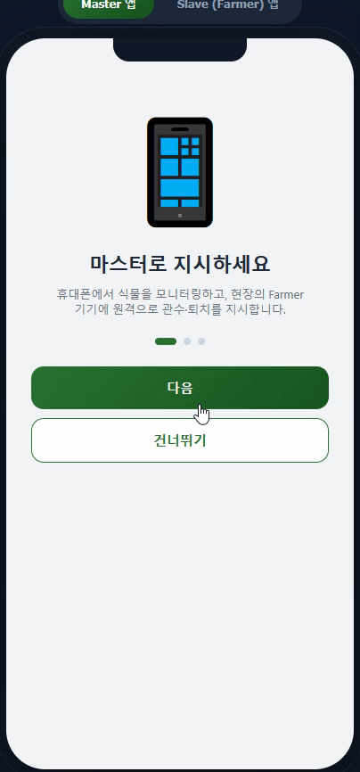
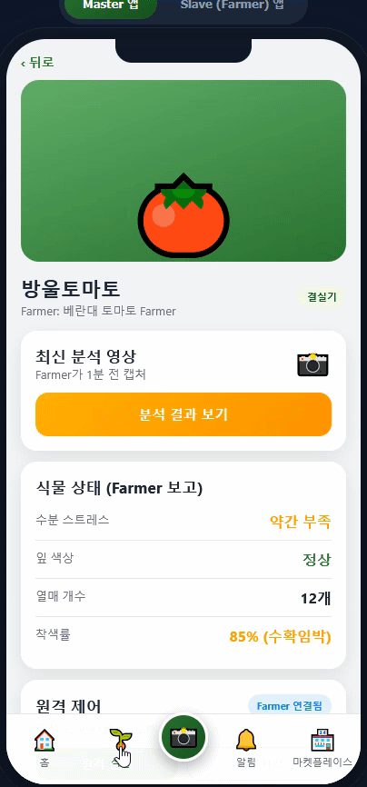
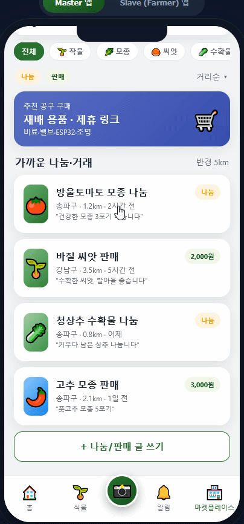

<p align="center">
  
</p>

<h1 align="center">OOJOO FARM</h1>

<p align="center">
  <strong>Grow. Care. Share. Harvest.</strong><br/>
  누구나 집에서 먹을 작물을 자율로 키울 수 있게 해 주는, 스마트폰 두 대로 된 안드로이드 시스템
</p>

<p align="center">
  
  
  
  
  
  
  
</p>

<p align="center"><a href="README.md">English</a> · <b>한국어</b></p>

<p align="center">
  <a href="https://www.youtube.com/shorts/wbNv0V2V0TQ">
    
  </a>
</p>

<p align="center"><sub>▶ YouTube Shorts 에서 OOJOO FARM 데모 보기</sub></p>

---

## OOJOO FARM 이란?

OOJOO FARM 은 단순한 아이디어에서 출발한 가정용 작물 재배 시스템입니다.

> **내 폰으로 무엇을 키울지 정하면, 식물 앞에 둔 남는 폰이 키운다.**

비싼 IoT 컨트롤러 대신, 쓰지 않는 저가 안드로이드 폰을 식물 옆의 전용 **Farmer** 로 씁니다. Farmer 는 온디바이스 AI 로 식물을 지켜보고, 물을 주고, 수확할 때가 되면 알려 줍니다. 내 폰은 주머니에 넣어 두고 **Master** 앱으로 모든 것을 확인합니다.

### 앱 두 개, 정원 하나

| 앱 | 설치하는 곳 | 역할 |
|-----|-------------|------|
| **Master** | 내 휴대폰 | 모니터링, 원격 제어, 알림, 가족 공유, 커뮤니티·마켓 |
| **Slave (Farmer)** | 식물 옆에 고정한 기기 | 상시 카메라 감시, 온디바이스 건강 CNN, 자율 관수, 하드웨어 제어 |

두 기기는 무작위로 만든 페어링 코드로 연결됩니다 — 복잡한 설정이 없습니다. 6자리 가족 코드로 가족·친구를 초대해 정원을 함께 돌볼 수 있습니다.

---

## 새로운 기능 (빌드 2026112012 – 2026112604)

**온디바이스 검출 모듈 — Master 에서 식물마다 추가·삭제** (빌드 2026112603)
- 식물마다 온디바이스 검출 모듈을 켭니다: 🌿 **건강상태 판별**(5단계), 🐛 **해충 검출**(4단계), 💧 **관수 주기 모니터링**(물 부족 / 적정 / 물 과다 + 관수 후 다시 마르기까지 걸리는 시간과 다음 관수 예상). model-manager 에서 만든 검출 모듈도 같은 목록에 나타납니다.
- 식물 카드의 `🧠 AI n` 버튼이나 식물 상세의 **AI 검출 모듈** 카드에서 모듈을 추가·삭제합니다. 서버가 바로 Farmer 에 알리고, Farmer 는 그 모듈의 OJP1 모델을 서버에서 내려받아(크기·SHA-256 검증, 해시로 보관, 쓰는 식물이 없으면 삭제) 그 식물의 RoI 를 판독하기 시작합니다.
- 판독은 RoI 진단 주기마다 **그리고 이벤트가 있을 때** 돕니다 — 모듈 추가 직후, Master 의 "지금 판독", 관수 직후(+30분 뒤 재확인), Fan/Laser 퇴치 1분 뒤, 건강등급 악화가 확정됐을 때. 결과는 판정이 바뀌거나 이벤트면 즉시, 같으면 5분마다 Master 로 돌아오고, 준비 상태(모델 받는 중 / 준비됨 / RoI 필요 / 종 모델 없음)도 함께 보입니다.
- 알림도 모듈을 따릅니다: 건강 변화 알림은 건강상태 모듈, 물 부족 알림과 RoI 자동 관수는 관수 모듈, 해충 알림은 해충 모듈이 켜져 있어야 합니다.
- 예전 서버에서도 동작합니다: Farmer 가 앱 내장 모델로 기존처럼 항상 켠 상태로 돌아갑니다.

**로컬 model-manager — 이 PC 에서 학습하고 서버와 GitHub 에 올린다** (2026-11-26)
- `scripts\model-manager.bat` → http://127.0.0.1:4900. 라벨과 학습 사진(직접 업로드, 식물 RoI 로 자른 Farmer 사진, 사람이 확정한 진단 프레임)을 관리하고, OJP1 모델을 로컬에서 미세조정하고, 새 버전을 같은 검증 사진에서 시작 버전과 비교합니다.
- **새 식물 종**(예: 이름 별칭으로 찾는 몬스테라 종 모델), **새로 감시할 상태**(진딧물 같은 라벨 추가 — 모델 출력이 하나 늘어남), **성능 저하**(틀리는 상태의 사진을 넣고 재학습)를 다룹니다.
- 성능 화면: 검증 정확도 / macro-F1 / 라벨별 재현율 / 혼동 행렬, 버전 이후 추가된 사진에서의 정확도, 일별·버전별 현장 신뢰도, 사람이 확정한 진단과의 일치율, "재학습 권장" 신호.
- 모든 것이 `ml/registry/` 에 파일로 남습니다(모델, 라벨, 학습/검증 분할이 붙은 사진, 지표가 붙은 버전). 버튼 하나로 버전을 라벨·지표·학습/검증 사진과 함께 서버에 올리고(토큰 보호) 원하면 바로 배포하며, 다른 버튼으로 그 모델 폴더를 GitHub 에 커밋합니다.

**Master 앱**
- 성장 사진첩 개편 — 대표 사진 넘기기, 썸네일 띠, 격자 보기, 확대 가능한 전체 화면 뷰어 — 와 같은 크기의 성장 스토리 숏클립 카드.
- 최근 이벤트를 통계부터: 그룹별 요약 타일, 14일 일별 누적 막대 그래프(탭/드래그, 표 보기), 유형별 순위, 현지 시각의 최근 기록.
- Farmer 사진 위 식물별 RoI 편집; 식물 위치를 옮길 수 있는 3×4 농장 화면, 움직이는 하늘(구름·새·비·밤하늘 별), Farmer 별 아이콘(선택 가능, 서버 동기화).
- 실시간 카메라 — LAN 직접 MJPEG 스트림 또는 3초마다 갱신되는 서버 중계.
- 이웃 탭은 농장 위치가 기본(내 위치·근처 검색 추가); 식물 카드의 나눔/판매 글에 성장 스토리 영상이 붙습니다.
- Farmer 카드에 페어링 코드 표시; 홈 날씨를 농장 날씨와 내 날씨로 분리.

**Farmer 앱**
- Master 와 동기화되는 식물별 RoI 모니터링(5분마다·변경 시 재동기화), 기기 위치로 지역 자동 설정, 사진첩을 갤러리(`Pictures/oojoo`)에 공개, 480px 썸네일, 화면이 꺼져도 계속 동작(카메라 재연결 + 부팅 시 재시작).

**백엔드**
- `/api/detectors`(모듈 카탈로그·모델 파일·식물별 모듈·판독 결과), `/api/models`(데이터셋이 붙은 버전 업로드·배포/롤백·현장 성능), `/api/events/:slaveId?days=N`, RoI·썸네일 API, 서버 중계 실시간 프레임, `/admin` 모니터링 페이지.
- GCP(`http://34.50.40.104:4000`)에서 운영 중이며, 두 앱의 기본 서버입니다.

**ML**
- 한 번에 돌리는 결정적 파이프라인으로 만든 종별 모델 14개 + 건강등급 5단계·해충 4단계 모델; Python ↔ JS ↔ Kotlin 일치 테스트로 학습·시뮬레이션·기기 추론 결과를 같게 유지합니다.

변경별 기록은 [`working_diary/`](working_diary/), 기능 명세는 [`docs/farmer-features.md`](docs/farmer-features.md) 와 [`docs/model-manager.md`](docs/model-manager.md), 코드 수준 지도(호출 흐름·상태 기계·데이터 모델·자동 생성 의존 그래프)는 [`docs/code-graph/README_kor.md`](docs/code-graph/README_kor.md) 에 있습니다.

<details>
<summary><b>이전 빌드</b> (2026081910 – 2026112011)</summary>

### 새로운 기능 (빌드 2026112011)

- **FCM 푸시 알림 (코드 완료, 설정 시 활성)** — Farmer 알림(`health_change`, `water_low`, `pest_detected`, `harvest_ready`, 그리고 SSE 가 끊겨도 도착해야 하는 `water_failed`, `battery_low`)이 Firebase Cloud Messaging 으로 소유자와 가족 구성원의 모든 등록 기기에 갑니다. 백엔드는 서비스 계정 JWT 로 FCM v1 HTTP API 를 쓰며(새 의존성 없음), Master 는 앱 내 알림과 같은 라벨·색으로 푸시를 표시합니다. 빌드에 `google-services.json` 이 필요 없습니다 — 백엔드 환경변수(`FCM_PROJECT_ID`, `FCM_SERVICE_ACCOUNT`)와 앱의 `FirebaseCfg` 를 채우면 코드 변경 없이 켜집니다.
- **토스페이먼츠 어댑터 (코드 완료, 설정 시 활성)** — `PG_MODE=toss`(+ `TOSS_SECRET_KEY`, `TOSS_WEBHOOK_SECRET`)로 마켓 결제를 실제 PG 로 처리합니다. 주문은 `pending_payment` 로 시작하고(재고 차감 없음), 서버가 결제를 만들어 승인 URL 을 주면 서버 확인·토스 웹훅(원문 기준 HMAC 검증)·클라이언트 상태 조회 중 먼저 도착한 것으로 마무리합니다. 결제 완료 처리는 멱등이라 확인과 웹훅이 동시에 와도 재고는 한 번만 줄어듭니다. `PG_MODE` 가 없으면 예전 그대로의 즉시 결제 데모입니다.
- **W5 안전장치, 테스트로 증명** — 과관수 방지 상태 기계(상승 엣지 히스테리시스, 30분 쿨다운, 밸브 오프라인 시 `water_failed`, `battery_low` 하강 엣지)를 `FarmerEngine.kt` 와 똑같이 PC 시뮬레이션(`simulation/src/engine/wateringSafety.js`)에 옮기고 결정적 테스트 9개로 확인했습니다(시뮬레이션 24/24 통과) — 실기기 없이 범람 수정이 검증됩니다.
- **개인화 한 번에** — `ml/plant_health/personalize.sh --species basil` 이 전체 과정(백엔드 DB → 사람이 확정한 진단 프레임 → 온디바이스 모델 미세조정 → 왕복 검증)을 돌리며, 확정 프레임이 없으면 실행하지 않습니다.
- **테스트 확대** — 백엔드 통합 테스트 61 → 83(FCM 6, 결제 16), 시뮬레이션 테스트 15 → 24; 모두 통과.

### 새로운 기능 (빌드 2026112010)

- **관수 안전 (Farmer)** — 자동 관수는 AI 의 물 필요 신호가 false→true 로 바뀌는 순간에만, 30분 재관수 쿨다운과 함께 동작합니다. "건조" 판정이 계속돼도 30초마다 밸브가 다시 열리지 않습니다. 수동·Master 지시 관수도 쿨다운을 갱신해 겹치지 않습니다.
- **하드웨어 신뢰성 (Farmer)** — BLE 하드웨어가 오프라인이면 관수를 "완료"로 보고하지 않고 `water_failed` 이벤트를 남깁니다. ESP32 연결은 자동 재연결(끊긴 뒤 5초, 15초 스캔 타임아웃 재스캔, 중복 스캔 방지, GATT 정리)합니다. 오프라인 이벤트·관수 큐는 뮤텍스로 직렬화해 동시 전송으로 기록이 사라지지 않습니다.
- **정확한 명령 완료** — 관수 / 사진 / 영상 / 영상 진단 명령은 실제로 작업이 끝난 뒤에만 `done` 처리됩니다(전에는 시작하자마자 done).
- **실제로 동작하는 정책** — Master 가 정한 `capture_interval`(10분–6시간)과 `pest_interval`(5–120분)이 Farmer 의 주기 촬영과 해충 대응 주기를 정합니다. 배터리 부족(20% 미만, 하강 엣지, 1시간 쿨다운)이면 Master 에 알립니다.
- **Master 앱** — 실제 데이터의 홈 대시보드, Farmer 화면의 정책 편집·이름 변경·명령 이력, 식물 상세의 수확 기록, 1:1 메시지, 프로필 편집, 알림에서 바로 이동, 끝없는 로딩 대신 오류+다시 시도.
- **백엔드 강화** — 경계값 검증 라이브러리, 관리자 통계 수정, 수확 API, 이벤트 일괄 전송, 명령 취소, 구독 적용, 5km 피드 반경 + 좌표 제거, 알림 읽음 상태, 1:1 메시지 API. 통합 테스트 61개 모두 통과.
- **ML** — 가장 약한 모델(선인장, val 0.611)을 검증된 시드로 재학습(val 0.685); `train.py` 에 재현용 `--seed`; 개인화 파이프라인(추출 → 분할 → 미세조정)을 16개 검증 E2E 테스트로 확인.
- **불필요한 코드·용량 제거** — 도달할 수 없는 온보딩 경로, 쓰지 않는 GLB 에셋 8.3MB, 죽은 composable 여러 개 삭제.

### 새로운 기능 (빌드 2026081910)

- **온디바이스 식물 건강 CNN × 8종** — 작은 자체 CNN(자체 `OJP1` 포맷, 모델당 약 20KB)이 방울토마토·바질·선인장·허브(로즈마리)·딸기·고추·호박·애호박에 대해 Farmer 폰에서만 돕니다. 건강 원인 6가지 — `healthy`, `water_low`, `water_high`, `light_low`, `pest`, `heat` — 를 분류하고 그에 맞춰 관수나 Fan 을 자동으로 켭니다. 화분 색에 흔들리지 않게 재학습했고, 떼어 둔 크리에이티브 커먼즈 웹 사진으로 평가했습니다.
- **가족 공유** — Master 소유자가 6자리 코드로 가족·친구를 초대하면, 같은 Farmer·식물·알림(관수, Fan, 레이저, 카메라)을 함께 쓰고 조작합니다.
- **성장 사진첩·숏클립** — Farmer 가 매일(또는 식물이 눈에 띄게 변하면) 사진을 남기고, Master 의 **숏클립 만들기**가 시간·위치 오버레이와 5음계 배경음악을 붙인 짧은 MP4 로 만듭니다 — 렌더링은 모두 Farmer 기기에서 합니다.
- **이메일/비밀번호 로그인** — 익명 빠른 시작에 더해 이메일 + 비밀번호 계정과 서버 세션을 지원합니다.
- **앱에서 서버 주소 변경** — 두 앱 모두 백엔드 주소를 검증과 `GET /health` 연결 확인 뒤 바꿀 수 있어, 에뮬레이터·LAN·배포 서버 사이를 쉽게 오갑니다.
- **한국어 / 영어** — 두 앱 모두 UI 언어 전환(재부팅해도 유지).
- **ML 도구** — 브라우저 라벨링 도구(`ml/plant_health/label_web/`), 데이터셋 수집기, 미세조정 스크립트, `ml/plant_health/metrics/` 의 종별 학습 지표.

빌드별 릴리스 노트는 [`docs/builds/`](docs/builds/) 를 보세요.

</details>

---

## 지역 사회에 왜 중요한가

집에서 키운 먹거리는 취미 이상입니다 — **먹거리 안전, 지속 가능성, 더 끈끈한 이웃**으로 가는 한 걸음입니다.

OOJOO FARM 은 채소·허브·과일을 직접 키우는 문턱을 낮춥니다. 모두가 매일 물을 줄 시간이 있거나, 해충과 병을 일찍 알아챌 지식이 있는 것은 아닙니다. 이미 가진 폰으로 어려운 부분을 자동화해, 신선하고 안전한 집 먹거리를 **가족, 초보자, 바쁜 직장인 모두**에게 열어 줍니다.

개인의 정원을 넘어, OOJOO FARM 은 **지역 재배 커뮤니티**를 만들도록 설계됐습니다.

- **수확 나누기** — 남는 채소를 몇 km 안의 이웃에게 올리세요. 음식물 쓰레기는 줄고 관계는 생깁니다.
- **함께 배우기** — 지역 피드에서 재배 팁을 나누고, 작물을 자랑하고, 처음 시작하는 사람을 돕습니다.
- **버리지 말고 다시 쓰기** — 서랍 속 오래된 안드로이드 폰이 전자 폐기물 대신 부지런한 정원사가 됩니다.
- **내 먹거리 알기** — 직접 키우면 접시에 무엇이 올라오는지 정확히 압니다. 정체 모를 농약도, 긴 유통 과정도 없이 햇빛과 물과 정성뿐입니다.

OOJOO FARM 의 정원 하나하나는 작은 자립입니다. 그 정원들이 모여 더 푸르고, 건강하고, 연결된 동네를 만듭니다.

---

## 구조

```
┌────────────────────────────┐                     ┌────────────────────────────────┐
│ Master 앱 (내 폰)          │                     │ Slave 앱 — Farmer              │
│ · 농장 화면 / 대시보드     │                     │ (식물 옆 고정 기기)            │
│ · 식물 카드: AI 검출 모듈  │                     │ · 카메라 + 식물별 RoI          │
│   추가 / 삭제              │                     │ · 검출 모듈 (OJP1):            │
│ · 이벤트·사진첩·숏클립     │                     │   건강 · 해충 · 관수           │
│ · 가족 / 커뮤니티 /        │                     │ · 자동 관수 / 해충 대응        │
│   마켓                     │                     │ · 성장 사진첩 + 클립 렌더링    │
└─────────────┬──────────────┘                     │ · 실시간 MJPEG 스트림 (:8613)  │
              │ REST + SSE                         └───────┬──────────────┬─────────┘
              ▼                                            │ REST + SSE   │ BLE
┌──────────────────────────────────────────────┐           │ (모델은      ▼
│ 클라우드 백엔드 — Node + SQLite (GCP)        │◀──────────┘  SHA-256    ┌──────────────────┐
│ 계정 · 페어링 · 식물 · 이벤트 · 사진         │              검증)      │ 밸브 / Fan /     │
│ 검출 모듈 카탈로그 · 모델 레지스트리 · 날씨  │                         │ 레이저 (ESP32)   │
└──────────────────────▲───────────────────────┘                         └──────────────────┘
                       │ 버전 + 라벨 + 학습/검증 사진 업로드 (토큰)
┌──────────────────────┴───────────────────────┐   git push
│ model-manager (내 PC, 127.0.0.1:4900)        │──────────────▶ GitHub (ml/registry/)
│ 라벨 · 학습 · 평가 · 배포                    │
└──────────────────────────────────────────────┘
```

---

## 주요 기능

### Master 앱
- **로그인** — 서버 세션을 쓰는 이메일/비밀번호 가입·로그인(가입 때 백엔드 주소와 재배 지역도 설정), 또는 익명 빠른 시작(닉네임 + 재배 지역). 백엔드 주소는 설정에서 연결 확인 후 언제든 바꿀 수 있습니다
- **대시보드** — 움직이는 3×4 농장 화면(식물 위치 이동, Farmer 별 아이콘, 살아 있는 하늘), 농장 날씨 + 내 날씨, 빠른 원격 관수
- **식물 관리** — 작물 등록, 성장 단계, 관수 기록, 수확 기록, Farmer 사진 위 식물별 RoI 편집
- **AI 검출 모듈** — 식물 카드(`🧠 AI n`)에서 식물마다 온디바이스 검출 모듈을 추가·삭제. 식물 상세에서 모듈별 최신 판독·신뢰도·판독 계기·모델 준비 상태·관수 주기를 보고 **지금 판독**
- **최근 이벤트 통계** — 그룹별 요약 타일, 탭/드래그와 표 보기가 되는 14일 일별 누적 그래프, 유형별 순위, 현지 시각의 최근 기록
- **성장 사진첩·숏클립** — 대표 사진 넘기기, 썸네일 띠, 격자, 확대 뷰어. 한 번 누르면 Farmer 가 성장 스토리 MP4(시간·위치 오버레이 + 배경음악)를 만들고, 같은 크기의 카드에서 재생
- **실시간 카메라** — LAN 직접 MJPEG 스트림 또는 3초 서버 중계
- **가족 공유** — 6자리 코드로 가족·친구 초대. 공유된 Farmer 와 식물에 "공유" 표시가 붙고 구성원 모두가 조작
- **Farmer 관리** — 기기 상태(온라인/오프라인), 자율 정책 설정, 일시정지/재개
- **페어링** — 무작위 6자리 코드 또는 QR, 10분 유효
- **원격 명령** — 오프라인 Farmer 에게도 관수·모드 변경 지시를 쌓아 둠
- **커뮤니티** — 농장 위치 주변(내 위치·근처 검색도)의 **나눔 / 판매 / 구매** 글(작물·수량·가격), 성장 스토리 영상이 붙은 식물 카드 글, 댓글, 예약/완료와 평판, 신고/차단
- **마켓** — 카테고리별 용품(비료, 씨앗, 밸브, ESP32, 센서, 추천 Farmer 폰), 검색, 식물 기반 추천, 묶음 키트, 장바구니·결제·주문 내역, 외부 상품 제휴 링크(CPS/CPA)
- **언어** — 앱 안에서 바꾸는 한국어 / 영어 UI

### Slave (Farmer) 앱
- **상시 카메라 감시** — CameraX 미리보기와 주기 촬영. 식물마다 화면 속 자기 RoI 를 판독
- **검출 모듈** — Master 가 식물마다 켠 모듈(건강 5단계, 해충 4단계, 관수 주기, model-manager 에서 배포한 분류 모듈)을 실행. 모델은 서버에서 받아 SHA-256 검증 후 보관하고, 주기적으로 그리고 이벤트(모듈 추가, 지금 판독, 관수, Fan/Laser, 건강 악화) 때 판독해 Master 에 보고
- **온디바이스 건강 CNN** — `PlantHealthNet` 이 14개 작물의 종별 작은 CNN(자체 `OJP1` 포맷, 약 20KB)을 기기에서만 실행. `healthy / water_low / water_high / light_low / pest / heat` 분류, 모르는 종은 색 통계로 대체
- **자율 관수** — CNN 이나 색 통계로 물 부족을 감지해 밸브를 자동으로 열고, 받아 둔 날씨로 양을 조정
- **해충 감지·대응** — CNN `pest` 클래스나 해충 휴리스틱 → 정책에 따라 Fan 자동, 레이저는 자동 또는 Master 승인
- **수확 감지** — 열매 익음 휴리스틱 → Master 에 수확 알림(중복 방지)
- **성장 사진첩·클립** — 하루 한 장(또는 눈에 띄는 변화 때) 사진을 남겨 서버와 동기화하고, Master 가 요청하면 시간·위치 오버레이와 5음계 배경음악이 붙은 MP4 를 만듦
- **하드웨어 제어** — 교체 가능한 `HardwareController`: BLE(ESP32 / Nordic UART Service)로 솔레노이드 밸브·Fan·레이저를 제어하고 **자동 꺼짐 안전 타이머** 내장. 하드웨어가 없으면 시뮬레이션 컨트롤러로 대체. 관수량에 비례해 밸브를 엶
- **오프라인 내성** — 네트워크 없이 24시간 이상 자율 동작. 보내지 못한 이벤트·관수 기록은 기기에 쌓았다가 **재연결 때 동기화**
- **헤드리스 모드** — 포그라운드 서비스 + wake lock 으로 화면이 꺼져도 엔진이 돌고, 재부팅 후 자동 재시작(BootReceiver), 하트비트로 배터리 보고
- **실시간 스트림·위치** — 8613 포트 MJPEG 카메라 스트림(요청 시 서버 중계), 기기 위치로 농장 지역 자동 설정
- **서버 재연결** — 설정에서 주소 검증과 `/health` 확인 후 백엔드 주소 변경, 페어링을 끊지 않고 엔진 재연결
- **언어** — 앱 안에서 바꾸는 한국어 / 영어 UI

### 백엔드
- **계정 API** — 익명 계정(닉네임 + 지역) **과** 세션 토큰을 쓰는 이메일/비밀번호 계정
- **가족 API** — `households` / `household_members` / `household_invites` 테이블, 6자리 초대 코드(이메일 선택), 페어링·식물·알림 조회가 가족 구성원 전체의 자원을 모음
- **사진 API** — 성장 사진첩용 `plant_photos` 테이블(식물별 업로드/조회)
- **영상 API** — 성장 클립 업로드(`kind=growth`, 사진 수)와 재생 URL
- 페어링 인증과 **세션 키 인증**(Farmer 쪽 API 는 `x-session-key` 필요)
- 식물·이벤트·관수 데이터 저장(빠른 조회용 인덱스)
- **명령 큐** — Master 가 명령을 올리고 Farmer 가 받아 실행
- **자율 정책 API** — Master 가 Farmer 별 정책(자동 관수 / Fan / 레이저 승인 / 촬영 주기 / 지역)을 정하고 Farmer 가 동기화
- **날씨 API** — 30분 캐시와 관수 가중치 계산이 붙은 Open-Meteo 연동
- **마켓 API** — 상품(카테고리/검색), 묶음 상품, 식물 기반 추천, 제휴 클릭 추적, 장바구니 결제(주문 + 재고 차감)와 주문 내역
- **커뮤니티 API** — 지역 피드(나눔/판매/구매)와 필터·검색, 댓글, 상태(예약/완료)와 평판 점수, 신고/차단
- **검출 모듈 API** (`/api/detectors`) — 배포 버전별 모델 URL / SHA-256 / 라벨이 담긴 모듈 카탈로그, 모델 파일 다운로드, 식물별 모듈 추가·삭제(Farmer 에 재동기화 명령), 판독 결과와 모델 준비 상태 보고
- **모델 API** (`/api/models`) — 로컬 model-manager 가 올리는 버전 받기(모델 + 라벨 + 지표 + 학습/검증 사진, `MODEL_MANAGER_TOKEN` 필요), 배포/롤백, 모델·버전별 현장 성능, 라벨링용 Farmer 사진 후보
- **이벤트 기간 조회** — `GET /api/events/:slaveId?days=N` 이 Master 통계용으로 기간 안 이벤트를 모두 돌려줌
- **모니터링 페이지** — `/admin`(API 사용량, 크래시, 기기)
- **상태 확인** — 두 앱이 서버 주소를 검증할 때 쓰는 `GET /health`

---

## 온디바이스 식물 건강 AI

모든 추론은 Farmer 폰에서 합니다 — 클라우드 추론이 없습니다. 앱에는 작은 CNN 들이 `android/slave/app/src/main/assets/models/`(`*.bin`, 개당 약 20KB)에 들어 있고, 새로 학습한 버전은 서버의 검출 모듈 카탈로그로 전달되어(아래 참고) 쓰기 전에 SHA-256 으로 검증됩니다.

| | |
|---|---|
| **포맷** | 자체 `OJP1`(헤더 + float32 가중치), `PlantHealthNet.kt` 가 읽음 |
| **구조** | 48×48 RGB 입력 → conv8-16-24 + GAP → 6클래스 dense |
| **클래스** | `healthy`, `water_low`, `water_high`, `light_low`, `pest`, `heat` |
| **종 (14)** | 방울토마토, 바질, 선인장, 허브(로즈마리), 딸기, 고추, 호박, 애호박, 상추, 깻잎, 대파, 고구마, 감자, 양파 |
| **동작** | `water_low` → 자동 관수 · `pest` → Fan 켜기 |

14개 모델은 Master 앱 식물 등록 목록의 작물을 모두 다룹니다(한글/영문 별칭으로 모델을 찾음 — 예: "토마토"→방울토마토, "로즈마리"→허브, "파"→대파). 모르는 종은 원래의 색 통계로 대체되므로 모든 식물이 자율 관리를 받습니다 — model-manager 에서 그 종의 모델을 배포하기 전까지.

### 검출 모듈 (식물마다 Master 에서 선택)

| 모듈 | 모델 | 출력 | 연결된 동작 |
|---|---|---|---|
| 🌿 건강상태 판별 `health_grade` | `health_grade.bin` (종 무관) | 매우건강 / 건강 / 보통 / 나쁨 / 매우나쁨 | `health_change` 알림 (연속 2회 관측으로 확정) |
| 🐛 해충 검출 `pest` | `pest.bin` (건강 모델과 별도) | 해충없음 / 경미 / 보통 / 심각 | `pest_detected` 알림, Fan/레이저 대응 |
| 💧 관수 주기 모니터링 `watering` | 그 식물의 종 모델 (`water_low` / `water_high`) | 물 부족 / 적정 / 물 과다 + 관수 후 경과 시간, 평균 마름 주기, 다음 관수 예상 | `water_low` 알림, RoI 자동 관수 |
| 사용자 모듈 | model-manager 에서 배포 | 정한 라벨 | Master 에 판독 표시 |

서버 카탈로그(`GET /api/detectors`)가 모듈마다 배포된 모델(URL, SHA-256, 크기, 출력 라벨)을 알려 주고, 식물 종 이름을 종 모델에 연결합니다. Farmer 는 시작할 때, 5분마다, 그리고 Master 가 식물의 모듈·RoI·담당 Farmer·종을 바꿀 때마다 동기화합니다. 명세: [`docs/farmer-features.md`](docs/farmer-features.md) §8.

### 학습 데이터 (`datasets/`)

종마다 결정적으로 생성한 합성 사진(화분 무관 페인터, 고정 시드)으로 된 라벨 데이터셋이 48×48 PNG 로 있습니다.

```
ml/plant_health/datasets/<species>/
├── healthy|water_low|water_high|light_low|pest|heat/0000.png…   # 전체 (gitignore, 로컬에서 재생성)
├── sample/<label>_00.png…                                       # 커밋된 샘플 (클래스당 2장)
└── manifest.json                                                # 시드, 개수, 클래스별 SHA-256 (커밋)
```

같은 시드면 바이트까지 같은 데이터셋이 나오고, `gen_dataset.py --verify` 가 해시를 다시 확인합니다. 네트워크가 있으면 웹 사진 수집(`fetch_*.py`)으로 실사진 미세조정도 할 수 있습니다.

### ML 파이프라인 (`ml/plant_health/`)

```
ml/plant_health/
├── train.py               # 종 하나 학습 (메모리 레시피 또는 --from-dataset)
├── train_all.py           # 모든 종 모델 학습
├── gen_dataset.py         # 데이터셋 생성 — 결정적 PNG + manifest + --verify
├── pipeline.sh            # 한 번에: 데이터셋 -> 검증 -> 학습 -> assets (검증 정확도 기준)
├── make_vectors.py        # Python↔JS 일치 벡터 (simulation/test/vectors_species.json)
├── train_health_grade.py  # 건강등급 5단계 모델 학습 (health_grade.bin)
├── train_pest.py          # 해충 4단계 모델 학습 (pest.bin)
├── grade_paint.py         # 등급/해충 학습용 합성 장면 페인터
├── species.py             # 종 목록, 라벨, 웹 검색어
├── fetch_curated.py       # CC 라이선스 학습 사진 수집
├── fetch_more.py          # 웹 사진 추가 수집
├── fetch_test_images.py   # 떼어 둔 웹 테스트셋 구성
├── finetune_web.py        # CC 웹 사진으로 미세조정
├── split_web.py           # 웹 사진 학습/테스트 분할
├── eval_internet.py       # 떼어 둔 웹 사진으로 평가
├── export_diagnosis.py    # 사람이 확정한 진단 프레임 추출 (개인화)
├── finetune_diagnosis.py  # 확정 진단 프레임으로 미세조정
├── personalize.sh         # 개인화 한 번에: 추출 -> 미세조정 -> 검증 (확정 데이터 없으면 거부)
├── test_personalization.py# E2E 테스트: DB 시드 -> 추출 -> 미세조정 (16개 검증)
├── label_web/             # 브라우저 라벨링 도구 (server.py + 웹 UI)
├── datasets/              # 종별 데이터셋 (샘플 + manifest 커밋, 전체는 로컬)
├── test_internet/         # 떼어 둔 웹 테스트셋 manifest·분할
└── metrics/               # 종별 학습 + 웹 평가 지표 (JSON/MD)
```

모델은 **화분 색에 무관**하게 학습합니다. 웹 평가는 크리에이티브 커먼즈 사진(Openverse / Wikimedia / iNaturalist)에 부족한 부분을 합성으로 채운 452장(`test_internet/`, 학습 360 / 테스트 92)을 쓰며, `eval_internet.py` 가 약 92장의 테스트 분할로 각 모델을 평가합니다. 학습은 Python/NumPy 로 로컬에서 돌고 GPU 나 클라우드가 필요 없습니다.

일치 검증: 시뮬레이션(`simulation/src/models/ojp1.js`)이 같은 `.bin` 파일을 그대로 읽고, 테스트가 모든 종 모델의 구조와 Python↔JS 로짓 일치(±1e-3)를 확인해 PC 시뮬레이션과 기기 추론을 같게 유지합니다.

```bash
cd ml/plant_health
bash pipeline.sh --all                 # 데이터셋 -> 검증 -> 학습 -> assets (14종, 약 5분)
bash pipeline.sh --species lettuce     # 종 하나
bash pipeline.sh --all --data-only     # 데이터셋만 (학습 없음)
MIN_ACC=0.80 bash pipeline.sh --all    # 검증 정확도 기준 올리기 (기본 0.75)
py -3 make_vectors.py                  # Python↔JS 일치 벡터 갱신
py -3 eval_internet.py                 # 웹 사진 평가
bash personalize.sh --species basil    # 개인화 (백엔드 DB 에 확정 진단 프레임 필요)
```

---

## model-manager (로컬)

출시 뒤에도 온디바이스 모델을 정확하게 유지하기 위한 로컬 웹 도구입니다 — 새 식물 종, 새로 감시할 상태, 성능 저하에 대응합니다. 학습은 내 PC 에서 하고, 결과는 서버(Farmer 배포)와 GitHub(기록)에 올립니다.

```bash
scripts\model-manager.bat                              # Windows: 처음 한 번 설치, http://127.0.0.1:4900 열기
cd ml/model-manager && npm install && npm start        # 다른 OS
```

1. **모으기** — 라벨과 학습 사진 추가: JPEG 직접 업로드, 서버에서 받아 식물 RoI 로 자른 Farmer 사진, 사람이 확정한 영상 진단 프레임. 라벨마다 사진 묶음의 약 20% 를 검증용으로 두며, 같은 사진·같은 날·같은 세션 사진은 학습과 검증에 나뉘어 들어가지 않습니다.
2. **학습** — 버전(또는 기반 모델)에서 worker thread 로 미세조정. 새 라벨은 출력을 하나 늘리고, L2-SP 가 사진이 적은 라벨의 기존 판독 능력을 지킵니다. 버전마다 검증 지표와 같은 사진에서의 시작 버전 점수를 기록합니다.
3. **확인** — 검증 정확도, macro-F1, 라벨별 재현율, 혼동 행렬; 버전 이후 추가된 사진에서의 정확도; 서버에서 가져온 일별·배포 버전별 현장 신뢰도와 사람 일치율; "재학습 권장" 신호.
4. **올리기** — *업로드*는 모델, 라벨(한/영), 지표, 그 버전의 학습/검증 사진(서버에 없는 것만)을 `POST /api/models/:id/releases` 로 보냅니다. *배포*하면 검출 모듈 카탈로그가 바뀌고 Farmer 가 새 모델을 받습니다. *GitHub* 은 `ml/registry/<model>/` 만 커밋해서 push 합니다.

```
ml/registry/<model>/model.json                   종류, 이름, 라벨(한/영), 종 별칭, 기반 모델
ml/registry/<model>/samples.json                 사진: 라벨, 학습/검증 분할, 출처, 묶음
ml/registry/<model>/samples/<sha256>.jpg         학습 사진 (256px)
ml/registry/<model>/versions/v<N>/version.json   출력 라벨, SHA-256, 지표, 시작 버전 비교, 학습 설정, 데이터셋 목록
ml/registry/<model>/versions/v<N>/model.bin      학습한 OJP1 모델 (v1 = backend/models 의 앱 내장 모델)
```

서버 업로드에는 백엔드에 설정한 `MODEL_MANAGER_TOKEN` 이 필요하고, 같은 값을 도구의 **설정**에 넣습니다(`ml/model-manager/.local/` 에 저장, 커밋 안 됨). 도구는 127.0.0.1 에만 열립니다. 자세한 안내: [`docs/model-manager.md`](docs/model-manager.md).

---

## 기술 스택

| 영역 | 기술 |
|-------|-----------|
| 모바일 | Kotlin, Jetpack Compose, Material 3, Navigation Compose |
| 네트워크 | Retrofit 2, OkHttp, kotlinx.serialization |
| 카메라 / 미디어 | CameraX (Preview, ImageCapture, ImageAnalysis), MediaCodec MP4/AAC 클립 렌더링 |
| 백엔드 | Node.js 22+, Express, SQLite (node:sqlite), GCP VM (systemd) 운영 |
| 날씨 | Open-Meteo API |
| 하드웨어 | BLE(Nordic UART Service) ESP32 — 안전 타이머가 붙은 밸브/Fan/레이저 |
| 온디바이스 AI | 자체 작은 CNN (`OJP1` 포맷, 모델당 약 20KB) — 종 모델 14개(6클래스), 건강등급 5단계, 해충 4단계; 서버에서 전달, SHA-256 검증 |
| ML 학습 | Python + NumPy (`ml/plant_health/`, 합성 기반 모델) · 로컬 model-manager 의 순수 JS OJP1 학습기 (`ml/model-manager/`) |
| 차트 | Compose Canvas (Master 일별 이벤트 그래프) · model-manager 의 인라인 SVG |
| 다국어 | 한국어(`ko`) / 영어(`en`), 앱별 언어 설정 유지 |

---

## 프로젝트 구조

```
OOJOO-FARM/
├── README.md               # 영문 README — 이 파일은 README_kor.md (한국어)
├── docs/                   # 문서
│   ├── prd.md              # 제품 요구사항 문서 (v1.1.0)
│   ├── DESIGN.md           # 설계 / 구조 메모
│   ├── farmer-features.md  # Farmer AI 기능, 검출 모듈 명세 (§8)
│   ├── model-manager.md    # 로컬 model-manager 안내
│   ├── code-graph/         # 코드 그래프: 흐름·상태 기계·데이터 모델 + 자동 생성 의존 그래프 (README_kor.md = 한국어)
│   └── builds/             # 빌드별 릴리스 노트 (2026112015 까지, 이후는 working_diary/)
├── working_diary/          # 변경별 작업일지 (요구사항, 변경, 검증, 남은 작업)
├── dist/                   # 빌드된 디버그 APK (저장소에 포함)
│   ├── oojoo-farm-master-debug.apk
│   └── oojoo-farm-farmer-debug.apk
├── scripts/                # 보조 스크립트
│   ├── build-dist.sh       # 두 앱 assembleDebug → dist/
│   ├── model-manager.bat   # 로컬 model-manager 실행 (Windows)
│   ├── sync-detector-models.mjs     # 재학습 후 앱 assets → backend/models
│   ├── make-ojp1-parity-fixture.mjs # JS 학습 모델 ↔ Kotlin 일치 fixture
│   ├── code-graph.mjs      # 소스에서 docs/code-graph/generated.md (+ generated_kor.md) 다시 생성
│   ├── start-backend.bat   # Windows 백엔드 실행
│   ├── run-emulator.bat    # Windows 에뮬레이터 실행
│   └── verify-locales.mjs  # 다국어 문자열 검사
├── assets/
│   ├── logo.svg            # 앱 로고
│   ├── icon.svg            # 앱 아이콘
│   └── demo.gif            # 프로토타입 애니메이션
├── prototype/
│   ├── index.html          # 인터랙티브 HTML 프로토타입 (브라우저로 열기)
│   ├── DEMO.mp4            # 프로토타입 전체 화면 영상
│   └── 38758–38760.gif     # Master 앱 UI 소개
├── backend/                # Node.js + Express + SQLite
│   ├── run-backend.sh      # Ubuntu 백엔드 실행
│   ├── models/             # 서버가 내려주는 OJP1 모델 (앱 내장 v1)
│   ├── test/               # node:test 통합 테스트
│   └── src/
│       ├── server.js
│       ├── db.js
│       ├── admin.html      # /admin 모니터링 페이지
│       ├── lib/            # household, detectors (모듈 카탈로그), validate, push, ...
│       ├── ml/             # ojp1 (모델 연산), registry (배포 버전), stats (현장 성능), defs
│       └── routes/         # users, pairing, plants, events, watering, commands, detectors, models,
│                           #   weather, household, photos, videos, live, community, market, ...
├── ml/
│   ├── plant_health/       # Python 학습 파이프라인, 라벨링, 평가, 지표 (위 참고)
│   ├── model-manager/      # 로컬 model-manager (server.mjs, ui/, lib/, test/)
│   └── registry/           # model-manager 가 관리하는 모델·라벨·학습 사진·버전
├── simulation/             # Farmer PC 시뮬레이션 (Node) + Python↔JS 일치 벡터
├── tools/                  # 개발 도구
│   └── gpu-hang-diagnostics/
└── android/                # 멀티 모듈 안드로이드 프로젝트
    ├── master/             # Master 앱 (com.oojoo.farm.master)
    │   └── app/src/main/
    │       ├── assets/server_config.yaml   # APK 에 들어가는 기본 서버 주소
    │       └── java/com/oojoo/farm/master/
    │           ├── MainActivity.kt
    │           ├── data/       # Prefs, Session, ServerConfig, ServerEndpoint
    │           ├── model/      # 데이터 모델
    │           ├── network/    # Retrofit API 클라이언트
    │           └── ui/         # Auth, Home (농장 화면), PlantList/Detail/Registration,
    │                          #   DetectorModules, EventStats, GrowthAlbum, RoiEditor, LiveCamera,
    │                          #   FarmerList, Family (가족), Pairing, Profile, Messages,
    │                          #   Notification, Community, Market, Report, ThemeEditor, ...
    └── slave/              # Slave/Farmer 앱 (com.oojoo.farm.slave)
        └── app/src/main/
            ├── assets/models/  # OJP1 가중치: 종 14개 + health_grade + pest, labels.json
            └── java/com/oojoo/farm/slave/
                ├── MainActivity.kt
                ├── album/      # PlantAlbum (성장 사진첩)
                ├── data/       # SharedPreferences (Prefs), ServerEndpoint
                ├── detect/     # 검출 모듈: DetectorManager, ModelStore (다운로드 + SHA-256),
                │               #   판독 계획 / 결과 보고 스로틀 / 관수 주기 추적
                ├── hardware/   # HardwareController: BLE (ESP32 NUS) + Mock, 안전 타이머
                ├── model/      # 데이터 모델
                ├── network/    # Retrofit API 클라이언트
                ├── service/    # 포그라운드 자율 엔진 (FarmerEngine), BootReceiver
                ├── vision/     # CameraX, PlantAnalyzer, PlantHealthNet (CNN),
                │               #   Ojp1 런타임, GrowthClipRenderer (MP4 + 배경음악)
                └── ui/         # Pairing, Dashboard, Settings, RoiEditor 화면
```

---

## 인터랙티브 프로토타입 체험

<p align="center">
  <video src="prototype/DEMO.mp4" width="400" controls muted loop autoplay alt="OOJOO FARM 프로토타입 데모">
    브라우저가 video 태그를 지원하지 않습니다. <a href="prototype/DEMO.mp4">데모 내려받기</a>
  </video>
</p>

개발 환경을 다 갖추지 않아도 지금 브라우저에서 OOJOO FARM 을 체험할 수 있습니다.

저장소에는 실제 휴대폰 화면 틀 위에서 Master 와 Slave(Farmer) 앱을 모두 흉내 내는 **완전한 인터랙티브 HTML 프로토타입**이 들어 있습니다. 빌드 도구도, 에뮬레이터도 필요 없이 파일을 열고 눌러 보면 됩니다.

위 영상은 전체 화면을 보여 줍니다 — Master 앱(스플래시, 온보딩, 홈 대시보드, 식물 상세, AI 스캔, 원격 관수, 알림, 수확 알림, 해충 감지, 페어링, 설정, 마켓, 글 목록, 채팅, 프로필, 도구)과 Slave/Farmer 앱(스플래시, 소개, 페어링, 카메라 가이드, 하드웨어 페어링, 자율 대시보드, 관수 이벤트).

### Master 앱 UX/UI 소개

<p align="center">
  
  &nbsp;
  
  &nbsp;
  
</p>

<p align="center"><sub>Master 앱 화면: 대시보드, 식물 모니터링, 원격 관수, 알림, 페어링, 커뮤니티 마켓</sub></p>

### 여는 방법

최신 브라우저에서 `prototype/index.html` 을 바로 여세요.

```
prototype/index.html
```

또는 저장소를 받아 파일을 더블클릭하면 됩니다.

### 둘러볼 것

맨 위의 전환 버튼으로 두 기기를 오갑니다.

#### Master 앱 (초록 테마)
| 화면 | 해 볼 것 |
|--------|-------------|
| **온보딩** | 3단계 소개 넘기기 — "폰으로 명령", "코드로 페어링", "Farmer 가 자율 관리" |
| **홈 대시보드** | 날씨 카드, Farmer 상태, 식물 캐러셀, 빠른 관수 버튼, 최근 알림(수확·해충) |
| **식물 상세** | 식물을 눌러 AI 분석 결과, 성장 지표(열매 수, 익음 %), 원격 제어, 이벤트 기록 보기 |
| **AI 스캔 결과** | 온디바이스 AI 감지(물 부족, 열매 수, 해충)가 표시된 카메라 화면 |
| **원격 관수** | "지금 물 주기"를 누르고 Farmer 로 명령이 가는 진행 막대 보기 |
| **수확 알림** | 익음 지표와 "수확 완료" 버튼이 있는 수확 알림 |
| **해충 감지** | Fan 자율 대응 기록과 레이저 수동 실행 |
| **페어링** | Farmer 연결용 6자리 코드 또는 QR 만들기 |
| **설정** | Farmer 기기, 자율 정책(자동 관수 / Fan 자동 / 레이저 승인), 알림 설정 |
| **마켓** *(Phase 3-4 미리보기)* | 근처 작물 나눔/판매 글, 카테고리, 제휴 용품점, 글쓰기, 이웃과 채팅, 평판이 있는 프로필 |
| **알림** | 수확·해충·관수·재연결 이벤트가 모인 알림 센터 |

#### Slave / Farmer 앱 (청록 테마)
| 화면 | 해 볼 것 |
|--------|-------------|
| **온보딩** | "온디바이스 AI 자율 관리", "코드로 페어링", "하드웨어 직접 제어" |
| **페어링** | 화면 키패드로 6자리 코드 입력 또는 QR 스캔 |
| **카메라 가이드** | 맞춤 가이드와 식물 인식 신뢰도가 표시된 카메라 화면 |
| **하드웨어 페어링** | BLE 스캔으로 ESP32 모듈(밸브, Fan, 레이저)을 찾아 연결 |
| **자율 대시보드** | 카메라 미리보기, 온디바이스 AI 상태(물 부족, 열매 감지, 해충 감지, AI 판단), 자율 정책 표, 최근 관수, 동작 기록, 헤드리스 모드 전환, 연결/배터리 상태 |
| **자율 관수 이벤트** | 관수를 실행하고 안전 타이머가 붙은 밸브 진행 막대 보기 |

> **참고:** 프로토타입은 가짜 데이터와 애니메이션을 씁니다 — 실제 백엔드 데이터가 아닌 의도한 UX 를 보여 줍니다. 제품 디자인 리뷰 때 쓴 바로 그 프로토타입입니다.

<p align="center">
   &nbsp; <em>프로토타입을 열고 Master 와 Farmer 를 오가며 전체 흐름을 보세요.</em>
</p>

---

## 시작하기

### 백엔드

**Node.js 22 이상**이 필요합니다(백엔드가 Node 22 부터 있는 내장 `node:sqlite` 를 씀).

```bash
cd backend
cp .env.example .env
npm install
npm start          # http://localhost:4000
```

자동 재시작 개발 모드: `npm run dev`

알아 둘 환경변수: `MODEL_MANAGER_TOKEN`(model-manager 의 모델 업로드·배포에 필요), `FCM_*`(푸시), `PG_MODE` / `TOSS_*`(결제) — `.env.example` 참고.

### model-manager

```bash
scripts\model-manager.bat                        # 또는: cd ml/model-manager && npm install && npm start
```

http://127.0.0.1:4900 → **설정**에서 서버 주소(기본값 GCP 백엔드)와 업로드 토큰을 넣습니다. [model-manager (로컬)](#model-manager-로컬) 참고.

### 배포 (GCP)

운영 백엔드는 GCP VM `oojoo-backend`(`asia-northeast3-a`, `http://34.50.40.104:4000`)에서 systemd 서비스 `oojoo` 로 돕니다. GitHub 에 push 한 뒤:

```bash
gcloud compute ssh oojoo-backend --zone=asia-northeast3-a --command="cd /opt/oojoo/repo && sudo -u wooju-family git pull --ff-only && cd backend && sudo -u wooju-family npm install && sudo systemctl restart oojoo && systemctl is-active oojoo"
```

`MODEL_MANAGER_TOKEN` 은 systemd drop-in `/etc/systemd/system/oojoo.service.d/model-manager.conf` 에 설정돼 있습니다. 배포 뒤 `/health`, `/api/detectors`, `/api/models` 를 확인하세요. 자세히: `.opencode/skills/deploy-backend-gcp/SKILL.md`.

### 안드로이드

1. **Android Studio** → **Open** → `android/` 폴더 선택
2. Gradle Sync 가 끝날 때까지 대기
3. 실행 구성에서 **app (master)** 또는 **app (slave)** 선택
4. **Run** (Shift+F10)

### 앱이 바라보는 서버 바꾸기

- 기본 서버 주소는 `android/*/app/src/main/assets/server_config.yaml` 에서 APK 로 들어갑니다 — 지금은 GCP 백엔드 `http://34.50.40.104:4000/` 이며, 다른 서버를 쓰려면 빌드 전에 고치세요(예: `http://<LAN-IP>:4000/`).
- 값이 없으면 에뮬레이터 기본값 `http://10.0.2.2:4000/` 을 씁니다.
- 두 앱 모두 **설정 → 서버 연결**에서 실행 중에 주소를 바꿀 수 있고, 저장 전에 주소 검증과 연결 확인(`GET /health`)을 합니다.

### 빌드된 APK

두 앱의 디버그 APK 가 [`dist/`](dist/) 에 있습니다.

```
dist/oojoo-farm-master-debug.apk    # 빌드 2026112603 — 식물 카드의 AI 검출 모듈
dist/oojoo-farm-farmer-debug.apk    # 빌드 2026112604 — 검출 모듈, 버전별 모델 라벨
```

`./scripts/build-dist.sh` 로 빌드합니다(JDK 17 + Android SDK 필요). 디버그 서명이라 다른 PC 에서 빌드한 APK 는 서명 키가 다릅니다. 다른 곳에서 빌드한 예전 버전이 깔린 폰은 먼저 삭제해야 하고, 그러면 Farmer 는 다시 페어링해야 합니다.

### 테스트

```bash
cd backend && npm test                  # node:test 통합 테스트
cd ml/model-manager && npm test         # 학습 엔진 + 업로드/배포 + GitHub E2E (임시 저장소)
cd simulation && npm test               # Farmer 시뮬레이션, Python↔JS 모델 일치
cd android && ./gradlew :master:app:testDebugUnitTest :slave:app:testDebugUnitTest
node scripts/verify-locales.mjs         # 한/영 문자열 짝 검사
```

### 언어

두 앱 모두 한국어가 기본이며 **설정**에서 영어로 바꿀 수 있고, 재부팅해도 유지됩니다. `node scripts/verify-locales.mjs` 로 문자열 짝을 검사합니다.

---

## 로드맵

| 단계 | 범위 | 상태 |
|-------|-------|--------|
| **Phase 1 — MVP** | 페어링, 카메라 촬영, 온디바이스 분석, 자율 관수, 명령 큐, 날씨 | ✅ 완료 |
| **Phase 2** | 수확/해충 감지, Fan/레이저 제어, BLE 하드웨어, 오프라인 동기화, 리포트 | ✅ 완료 |
| **Phase 3** | 위치 기반 커뮤니티(나눔/판매/구매), 댓글, 평판, 신고·차단 | ✅ 완료 |
| **Phase 4** | 마켓, 장바구니/결제, 제휴 링크, 구독 요금제 | ✅ 완료 |
| **Phase 5** | 온디바이스 CNN 건강 모델(8종, OJP1), 가족 공유, 성장 클립, 이메일/비밀번호 로그인, 한/영, 여러 Farmer·작물 | ✅ 완료 |
| Phase 6 | FCM 푸시(설정 시 활성), 토스페이먼츠 어댑터(`PG_MODE`, 설정 시 활성), 개인화 한 번에(`personalize.sh`), 종 모델 확대 | 🔶 코드 완료 (설정 시 활성) |
| **Phase 7** | 식물별 RoI 모니터링, 실시간 카메라, 농장 화면, 성장 사진첩·이벤트 통계, 온디바이스 검출 모듈(식물마다 추가·삭제, 서버 전달 모델), 로컬 model-manager(라벨 · 학습 · 평가 · 서버와 GitHub 에 업로드) | ✅ 완료 (실기기 현장 테스트 남음) |

> **Phase 6 은 코드가 완료됐고 설정하면 켜집니다**: FCM 은 백엔드 환경변수(`FCM_PROJECT_ID`, `FCM_SERVICE_ACCOUNT`)와 Master 앱의 `FirebaseCfg`(`google-services.json` 값)를 채우는 순간 켜지며, 그 전에는 빌드에 영향 없이 꺼져 있습니다. 토스페이먼츠는 `PG_MODE=toss` + `TOSS_SECRET_KEY`(+ `TOSS_WEBHOOK_SECRET`)로 켜지고, 기본은 즉시 결제 데모입니다. 온디바이스 추론은 실제로 학습한 CNN(자체 `OJP1` 포맷)을 쓰며 클라우드가 필요 없습니다.

전체 제품 요구사항은 [`docs/prd.md`](docs/prd.md), 빌드별 릴리스 노트는 [`docs/builds/`](docs/builds/) 에 있습니다.

---

## 라이선스

Proprietary — WOOJU INDUSTRY. All rights reserved.

---

<p align="center">
  <em>"Master 폰이 명령하고, Farmer 폰이 키운다. 누구나 집에서 심고, 키우고, 나누고, 거둔다."</em>
</p>

<p align="center">
  Built by <strong>WOOJU INDUSTRY</strong>
</p>
