# OOJOO FARM code graph

> As of 2026-11-26. A map, drawn as graphs, of "what calls what and where the data flows" at the code level.
> Diagrams are Mermaid — GitHub renders them directly. 한국어: [README_kor.md](README_kor.md)
>
> - **This document**: hand-written structure, flows, state machines and data model (file and function names match the code)
> - **[generated.md](generated.md)**: module dependency graphs and the API map built from the sources by `node scripts/code-graph.mjs` (regenerate after changing code)

## Contents

1. [System at a glance](#1-system-at-a-glance)
2. [Component maps](#2-component-maps)
3. [Key flows](#3-key-flows) — pairing and commands / adding a detector module / RoI reading round / watering event / model-manager training and deployment / GitHub / plant detail screen
4. [State machines](#4-state-machines)
5. [Data model](#5-data-model)
6. [Feature → file lookup](#6-feature--file-lookup)

---

## 1. System at a glance

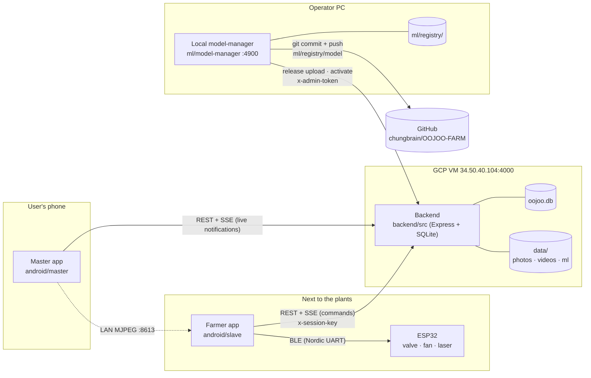

| Component | Entry point | Role |
|---|---|---|
| Master app | `MainActivity.kt` (Navigation Compose routes) | The user's phone — manage plants and Farmers, remote commands, notifications, community and market |
| Farmer app | `service/FarmerService.kt` → `service/FarmerEngine.kt` | A phone fixed next to the plants — camera readings, autonomous watering and pest response, hardware control |
| Backend | `server.js` → `app.js` | Accounts, pairing, plants, events, photos, command queue, detector module catalog, model registry |
| model-manager | `ml/model-manager/server.mjs` | Operator PC — labels, training photos, training and evaluation, upload to the server and GitHub |

---

## 2. Component maps

### 2.1 Farmer app — centered on `FarmerEngine`

`FarmerEngine` (a singleton `object`) runs every loop. The UI (`DashboardScreen`) and the background service (`FarmerService`) share the same instance.

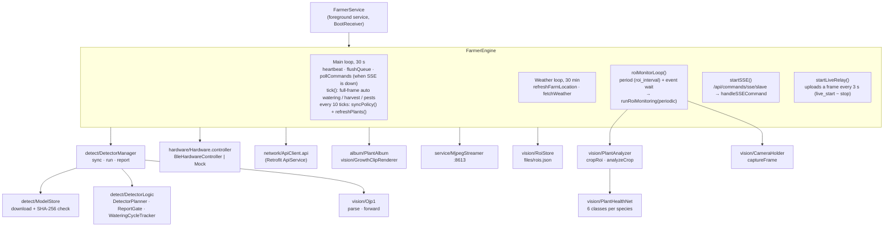

### 2.2 Master app — screens · ViewModels · API

Each screen's ViewModel calls `ApiClient.api` (Retrofit). Shared state lives in `data/` (Session, Prefs, AppLocale); every DTO is in one file, `model/Models.kt`.

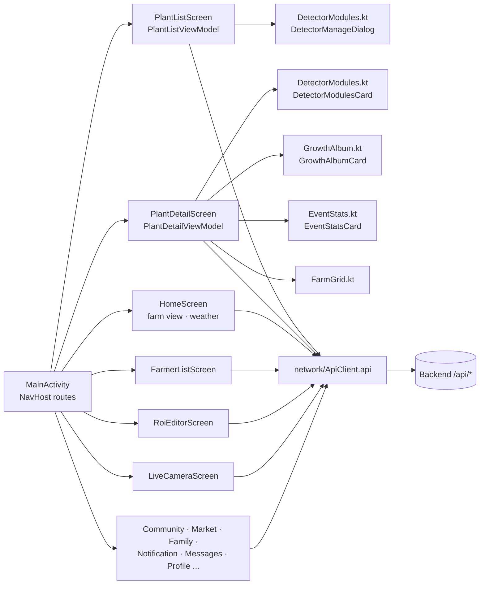

### 2.3 Backend — routers and shared modules

`app.js` mounts 26 routers at `/api/<name>`. Detector modules and the model registry are handled by `lib/detectors.js` + `ml/`. (Full import graph: [generated.md §1](generated.md#1-backend))

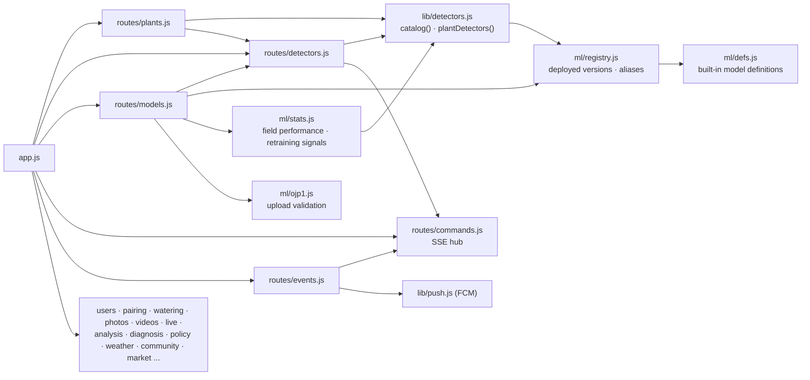

### 2.4 Local model-manager

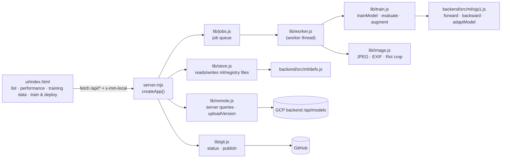

---

## 3. Key flows

### 3.1 Pairing → heartbeat → commands

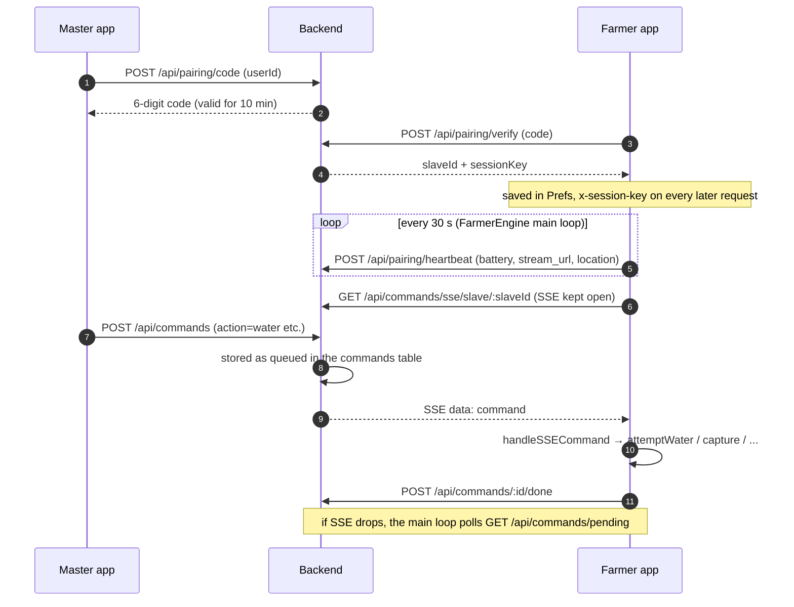

### 3.2 Adding a detector module → the Farmer fetches the model

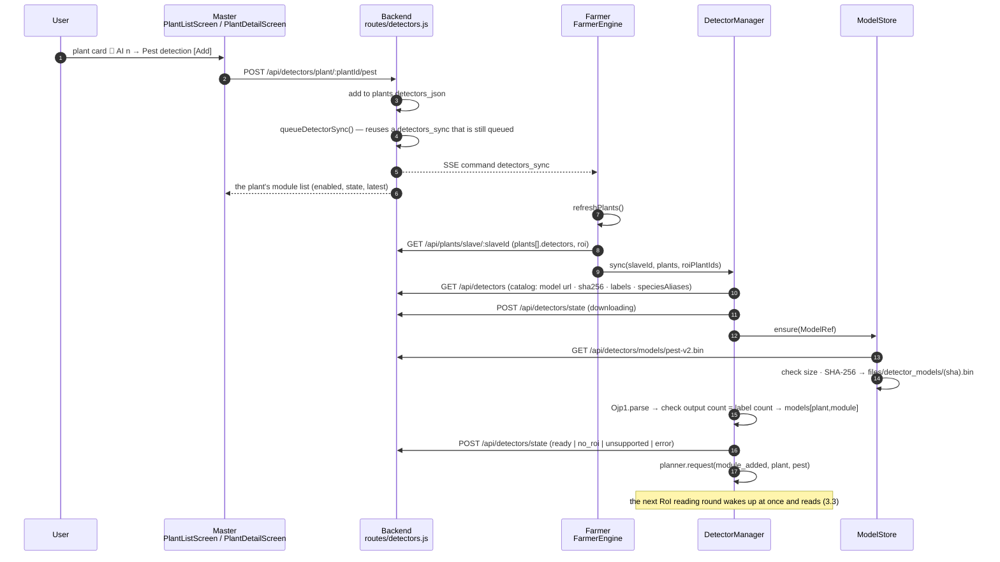

Removal takes the same path: `DELETE /api/detectors/plant/:plantId/:moduleId` → `detectors_sync` → `sync()` drops the module from `models` and `latest`, and `ModelStore.retainOnly()` deletes model files that are no longer used.

### 3.3 RoI reading round (periodic + events)

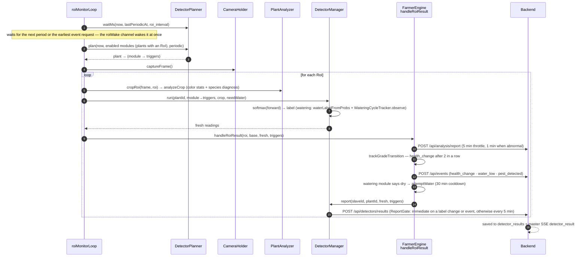

Event triggers (`Triggers`): `module_added` · `run_now` (Master "Read now" → `run_detectors` command) · `watered` / `watered_followup` (+30 min) · `pest_response` (fan/laser, +1 min) · `health_drop` (confirmed grade drop) · `roi_changed`.

### 3.4 Watering → watering cycle record

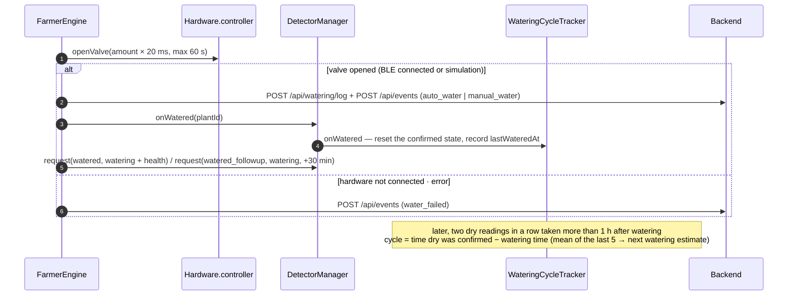

### 3.5 model-manager: photos → training → server deployment

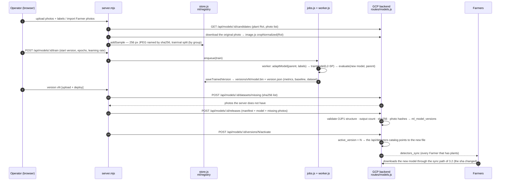

### 3.6 Publishing to GitHub

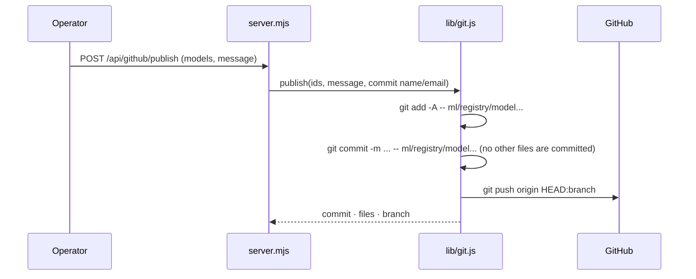

### 3.7 Data read by the Master plant detail screen

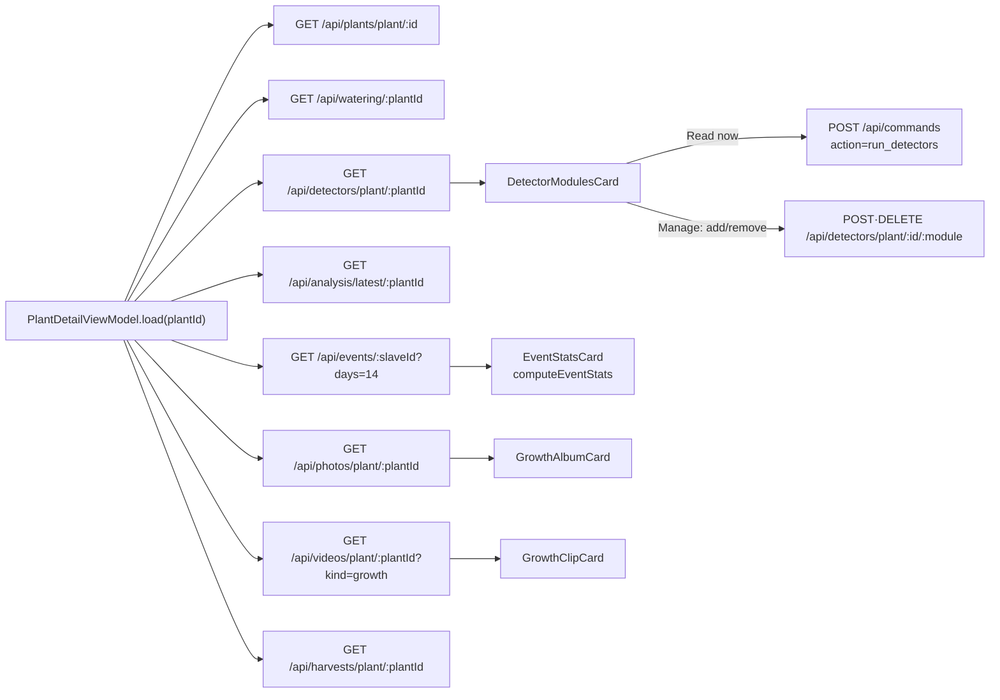

---

## 4. State machines

### 4.1 Confirming a health-grade transition (`FarmerEngine.trackGradeTransition`)

So that a single misclassified round does not raise a notification, a new (grade, pest) combination is confirmed only after it is observed **twice in a row**.

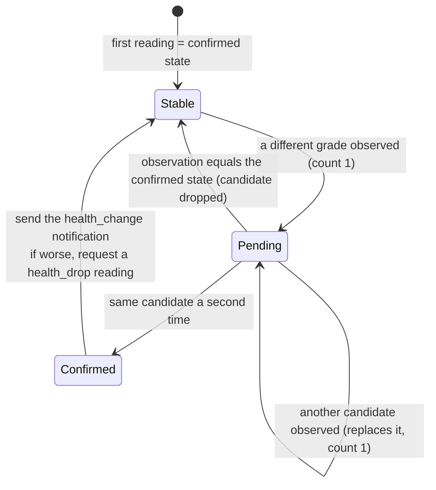

### 4.2 Watering cycle (`WateringCycleTracker`)

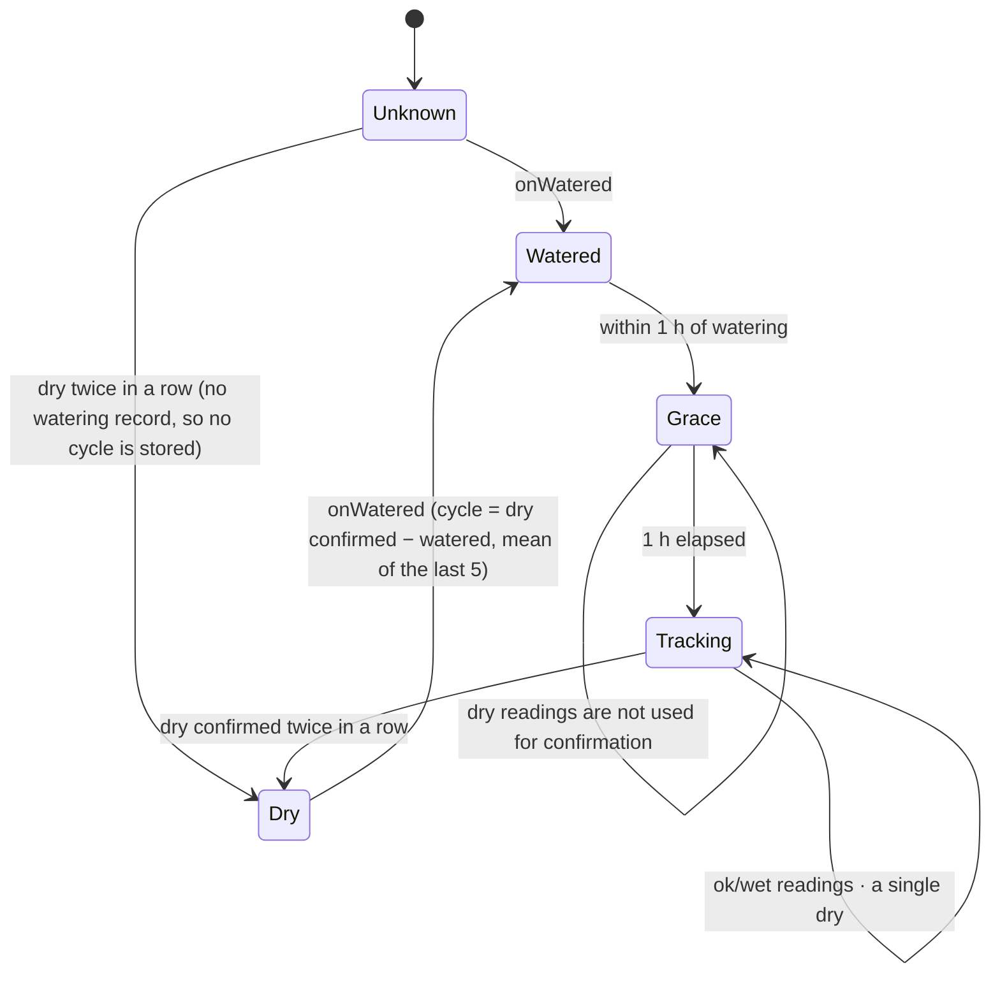

### 4.3 Module model readiness (`DetectorManager.prepare` → `/api/detectors/state`)

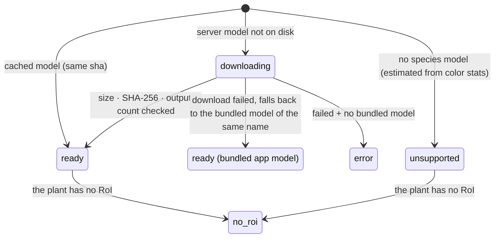

---

## 5. Data model

SQLite (`backend/data/oojoo.db`). Focused on the farm, detector and model tables (community, market, family and payment tables are omitted).

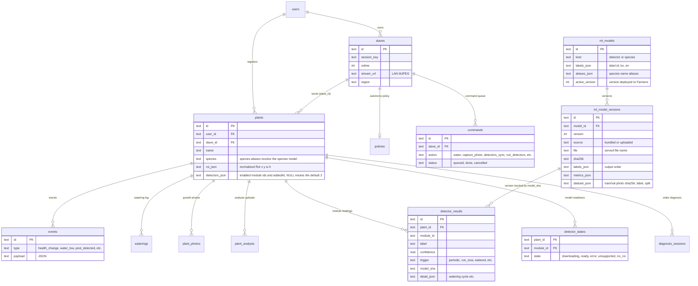

The local registry (`ml/registry/<model>/`) holds the same information as files — `model.json` (= ml_models), `versions/vN/version.json` (= ml_model_versions + training history and evaluation), `samples.json` + `samples/<sha256>.jpg` (training photos). On the server, `ml_model_versions.dataset_json` is the photo list of an uploaded version, and the photo files live in `data/ml/datasets/<model>/<sha256>.jpg`.

---

## 6. Feature → file lookup

| Feature | Master | Farmer | Backend | Local tool |
|---|---|---|---|---|
| Pairing · heartbeat | `ui/PairingScreen.kt` | `ui/PairingScreen.kt`, `FarmerEngine.start` | `routes/pairing.js` | |
| Remote commands (SSE) | `network/ApiService.sendCommand` | `FarmerEngine.startSSE / handleSSECommand / pollCommands` | `routes/commands.js` | |
| Adding/removing detector modules | `ui/DetectorModules.kt`, `PlantListScreen`, `PlantDetailScreen` | `detect/DetectorManager.sync` | `routes/detectors.js`, `lib/detectors.js` | |
| Model download · verification | | `detect/ModelStore.kt` | `GET /api/detectors/models/:file` | |
| RoI reading round | `ui/RoiEditorScreen.kt` (sets the RoI) | `FarmerEngine.roiMonitorLoop / runRoiMonitoring / handleRoiResult`, `detect/DetectorLogic.kt` | `routes/detectors.js` results · state | |
| Watering cycle | detail card `WateringLines` | `WateringCycleTracker`, `FarmerEngine.attemptWater` | `wateringCycle()` in `routes/detectors.js` | |
| Event statistics | `ui/EventStats.kt` | `postEventSafe`, offline queue | `routes/events.js` (`?days=N`) | |
| Growth album · clips | `ui/GrowthAlbum.kt`, `PlantDetailScreen.GrowthClipCard` | `album/PlantAlbum`, `vision/GrowthClipRenderer` | `routes/photos.js`, `routes/videos.js` | |
| Live camera | `ui/LiveCameraScreen.kt` | `service/MjpegStreamer`, `FarmerEngine.startLiveRelay` | `routes/live.js` | |
| Model training | | | | `lib/train.js`, `lib/worker.js`, `lib/jobs.js` (math: `backend/src/ml/ojp1.js`) |
| Model upload · deployment | | | `routes/models.js`, `ml/registry.js` | `lib/remote.js uploadVersion` |
| Field performance · retraining signals | | | `ml/stats.js` | `server.mjs localHealth` |
| Publishing to GitHub | | | | `lib/git.js publish` |

### Boundaries guarded by tests

| Boundary | Tests |
|---|---|
| Python training ↔ JS forward | `ml/model-manager/test/engine.test.js` (reference vectors), `simulation/test/species_models.test.js` |
| JS training output ↔ Kotlin forward | `android/slave/.../detect/TrainedModelParityTest.kt` (fixture: `scripts/make-ojp1-parity-fixture.mjs`) |
| Server responses ↔ app DTOs | `DetectorContractTest.kt` (farmer), `DetectorModulesTest.kt` (master) — fixtures produced by the real backend |
| Detector module API | `backend/test/detectors.test.js` |
| Release upload · activation | `backend/test/model_releases.test.js` |
| Local tool end to end | `ml/model-manager/test/local.test.js` (real backend + temporary git repository) |
| Farmer reading plan · cycle · throttling | `DetectorLogicTest.kt`, `ModelStoreTest.kt` |

---

Regenerate the generated graphs: `node scripts/code-graph.mjs` (check only: `--check`)
