# OOJOO FARM 코드 그래프

> 2026-11-26 기준. 코드 수준에서 "무엇이 무엇을 부르고, 데이터가 어디로 흐르는지"를 그래프로 정리했다.
> 다이어그램은 Mermaid — GitHub 에서 바로 그려진다.
>
> - **이 문서**: 사람이 정리한 구조·흐름·상태·데이터 모델 (파일·함수 이름은 실제 코드 기준)
> - **[generated.md](generated.md)**: `node scripts/code-graph.mjs` 가 소스에서 만든 모듈 의존 그래프와 API 지도 (코드를 바꾸면 다시 생성)

## 목차

1. [시스템 한눈에](#1-시스템-한눈에)
2. [구성 요소 지도](#2-구성-요소-지도)
3. [핵심 흐름](#3-핵심-흐름) — 페어링·명령 / 검출 모듈 추가 / RoI 판독 회차 / 관수 이벤트 / model-manager 학습·배포 / GitHub / 식물 상세 화면
4. [상태 기계](#4-상태-기계)
5. [데이터 모델](#5-데이터-모델)
6. [기능 → 파일 찾기](#6-기능--파일-찾기)

---

## 1. 시스템 한눈에

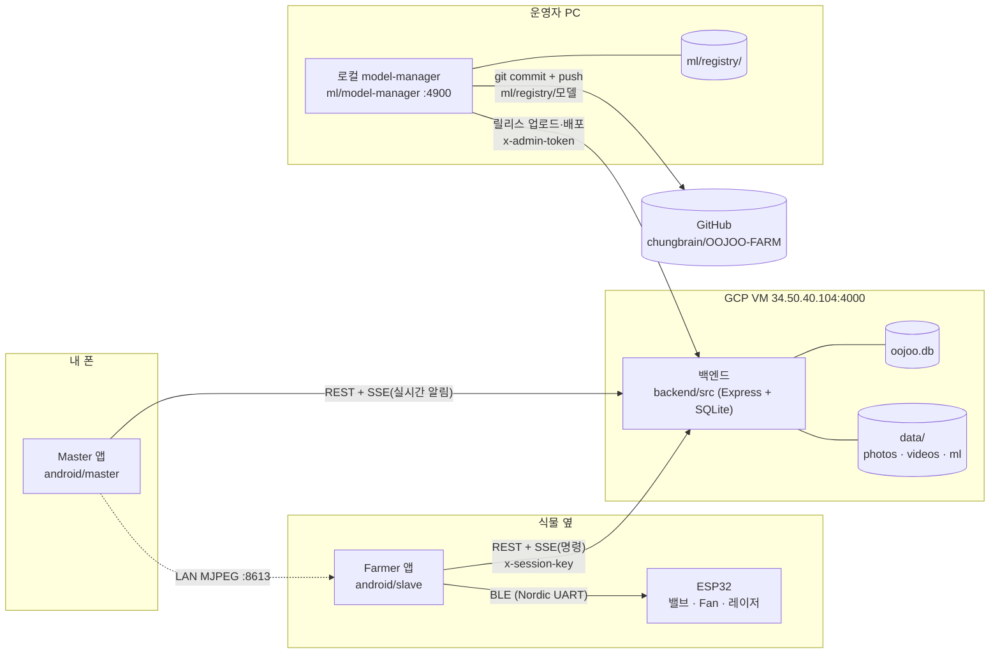

| 구성 요소 | 진입점 | 역할 |
|---|---|---|
| Master 앱 | `MainActivity.kt` (Navigation Compose 라우트) | 사용자 폰 — 식물·Farmer 관리, 원격 명령, 알림, 커뮤니티·마켓 |
| Farmer 앱 | `service/FarmerService.kt` → `service/FarmerEngine.kt` | 식물 옆 고정 폰 — 카메라 판독, 자율 관수·해충 대응, 하드웨어 제어 |
| 백엔드 | `server.js` → `app.js` | 계정·페어링·식물·이벤트·사진·명령 큐·검출 모듈 카탈로그·모델 레지스트리 |
| model-manager | `ml/model-manager/server.mjs` | 운영자 PC — 라벨·학습 사진·학습·평가, 서버/GitHub 업로드 |

---

## 2. 구성 요소 지도

### 2.1 Farmer 앱 — `FarmerEngine` 중심

`FarmerEngine` (object, 싱글턴)이 모든 루프를 돌린다. UI(`DashboardScreen`)와 백그라운드(`FarmerService`)가 같은 인스턴스를 공유한다.

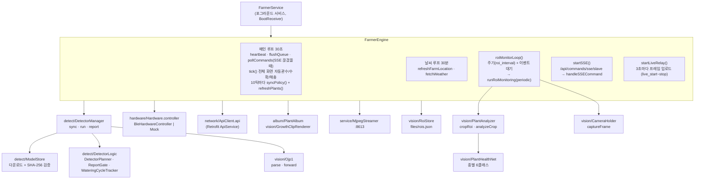

### 2.2 Master 앱 — 화면 · ViewModel · API

화면마다 ViewModel 이 `ApiClient.api`(Retrofit)를 부른다. 공용 상태는 `data/`(Session, Prefs, AppLocale), 모델은 `model/Models.kt` 한 파일.

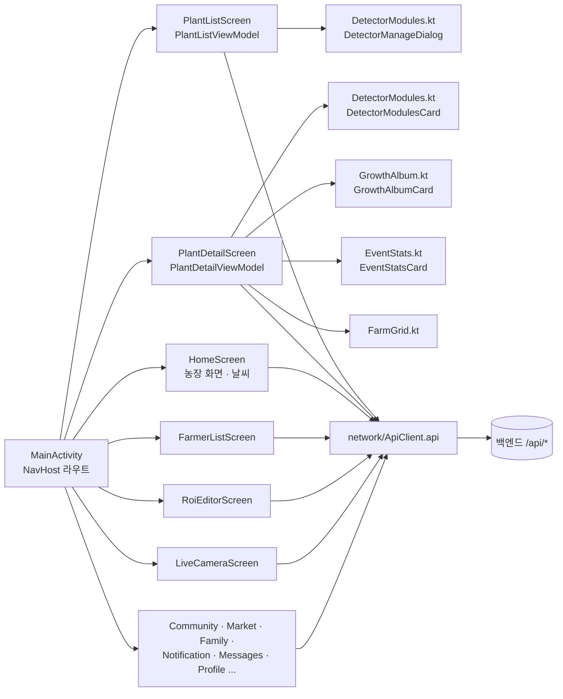

### 2.3 백엔드 — 라우터와 공용 모듈

`app.js` 가 라우터 26개를 `/api/<이름>` 에 붙인다. 검출 모듈·모델 레지스트리는 `lib/detectors.js` + `ml/` 가 맡는다. (전체 import 그래프: [generated.md §1](generated.md#1-백엔드))

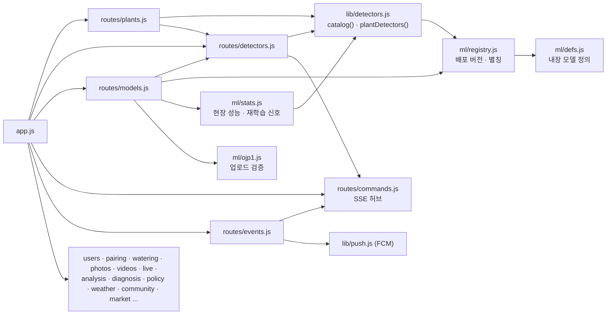

### 2.4 로컬 model-manager

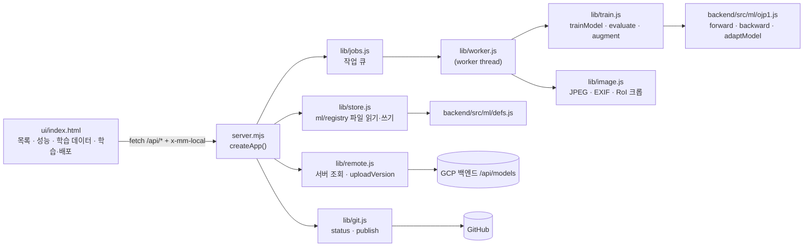

---

## 3. 핵심 흐름

### 3.1 페어링 → 하트비트 → 명령

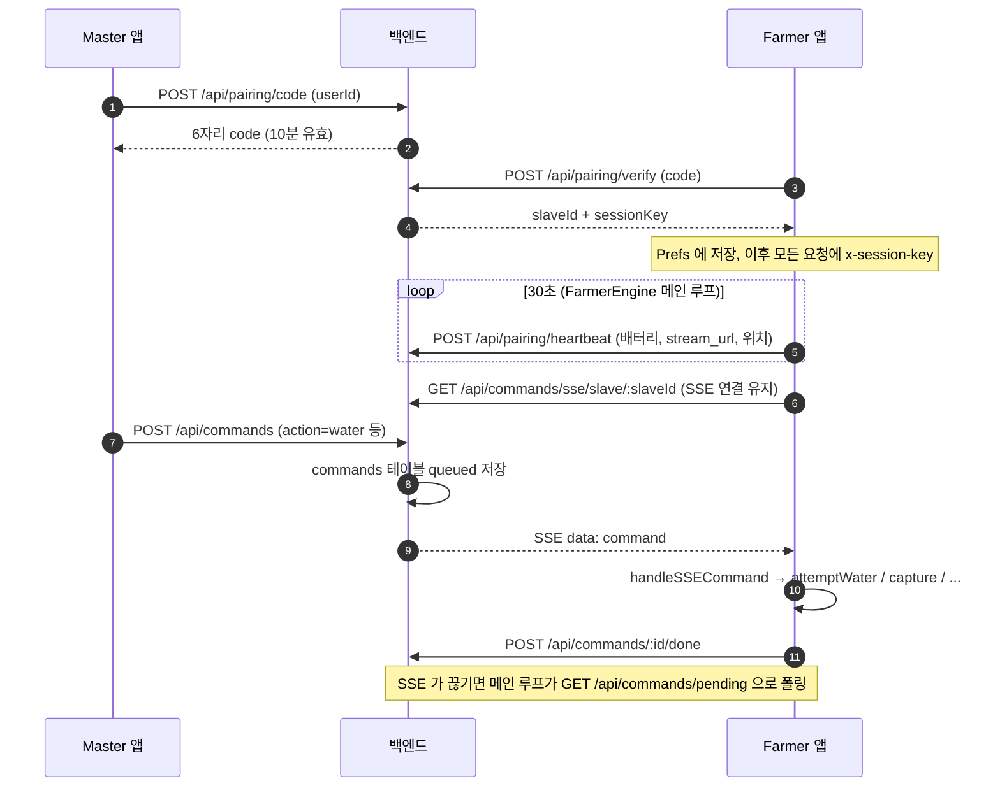

### 3.2 검출 모듈 추가 → Farmer 가 모델을 받는다

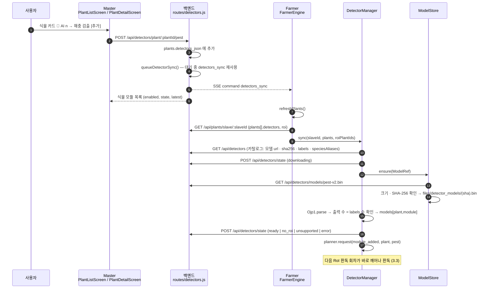

삭제도 같은 경로: `DELETE /api/detectors/plant/:plantId/:moduleId` → `detectors_sync` → `sync()` 가 `models`·`latest` 에서 빼고 `ModelStore.retainOnly()` 로 쓰지 않는 모델 파일을 지운다.

### 3.3 RoI 판독 회차 (주기 + 이벤트)

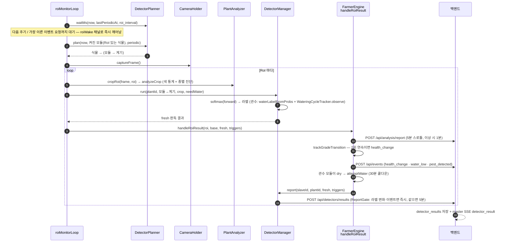

이벤트 계기 (`Triggers`): `module_added` · `run_now`(Master 지금 판독 → `run_detectors` 명령) · `watered` / `watered_followup`(+30분) · `pest_response`(Fan/Laser +1분) · `health_drop`(등급 악화 확정) · `roi_changed`.

### 3.4 관수 → 관수 주기 기록

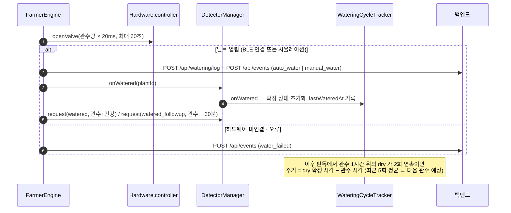

### 3.5 model-manager: 사진 → 학습 → 서버 배포

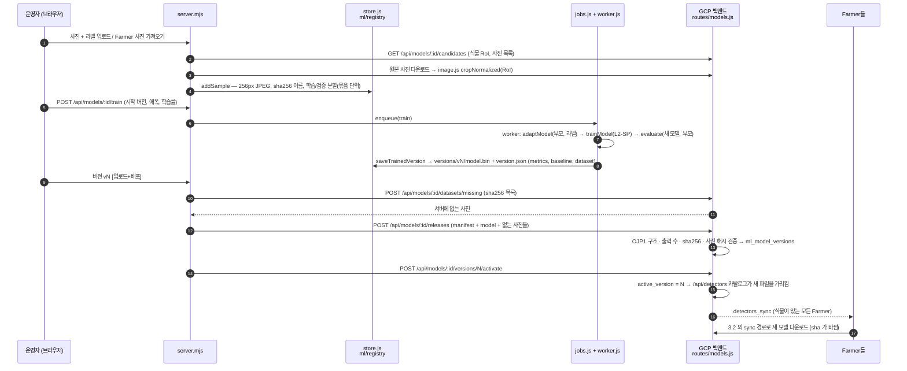

### 3.6 GitHub 올리기

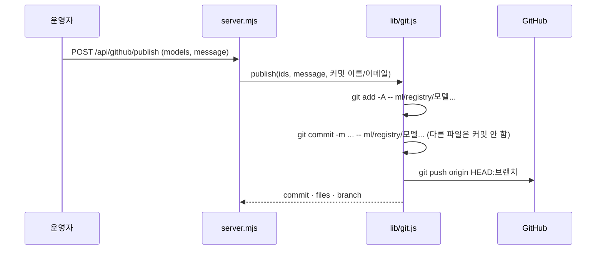

### 3.7 Master 식물 상세 화면이 읽는 데이터

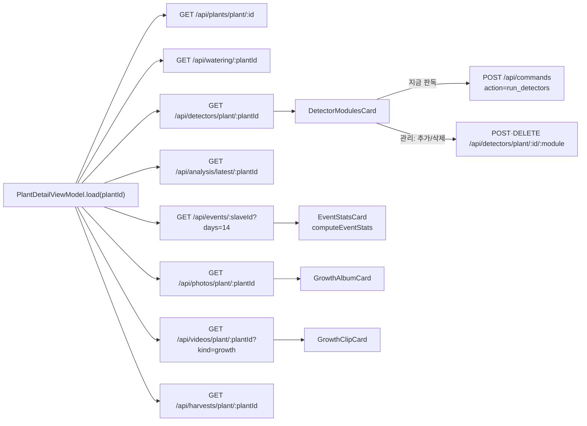

---

## 4. 상태 기계

### 4.1 건강등급 전이 확정 (`FarmerEngine.trackGradeTransition`)

단일 회차 오분류가 알림을 만들지 않도록, 새 (등급, 해충) 조합이 **연속 2회** 관측돼야 확정한다.

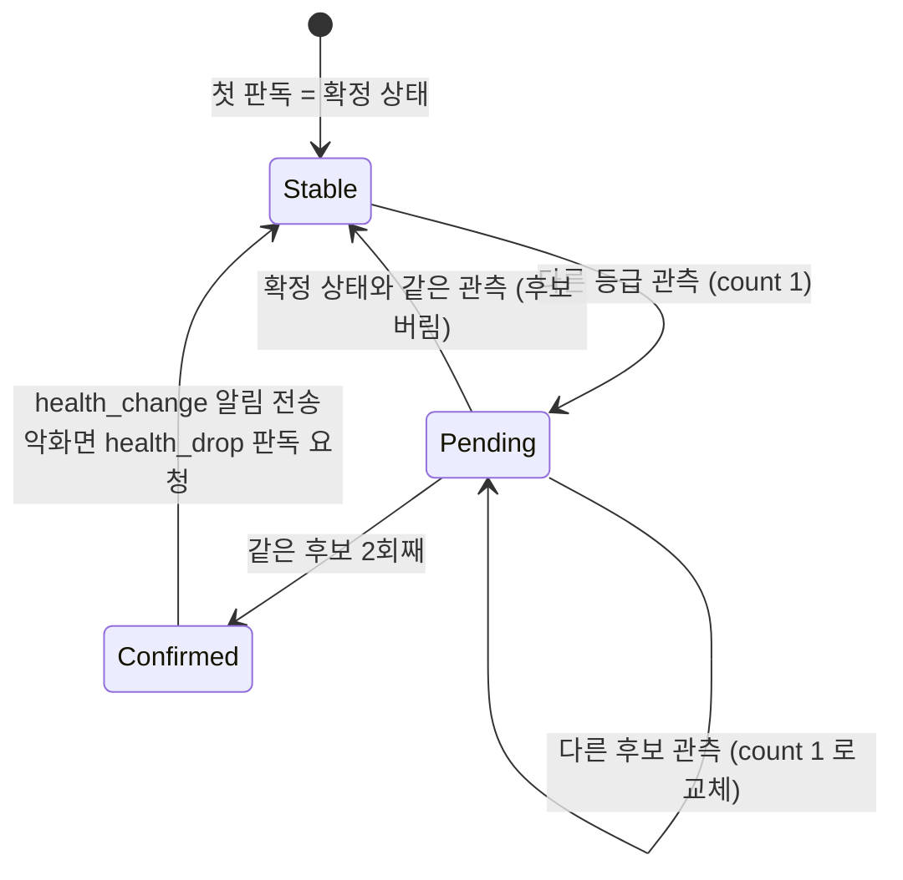

### 4.2 관수 주기 (`WateringCycleTracker`)

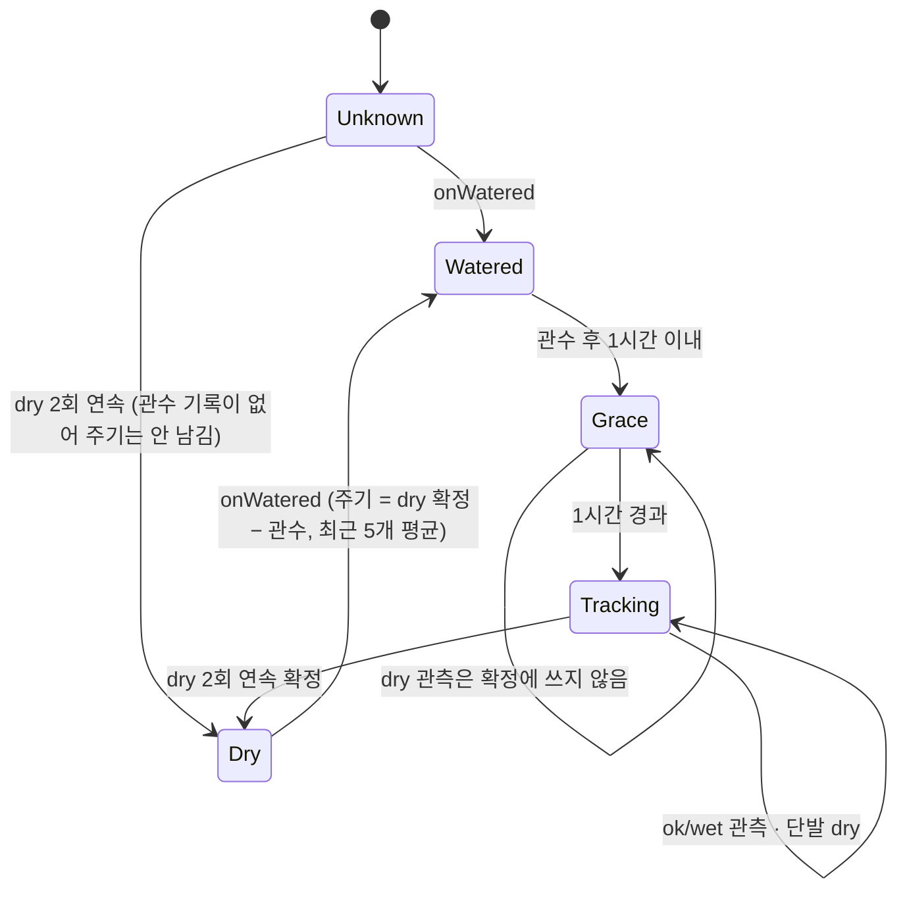

### 4.3 모듈 모델 준비 상태 (`DetectorManager.prepare` → `/api/detectors/state`)

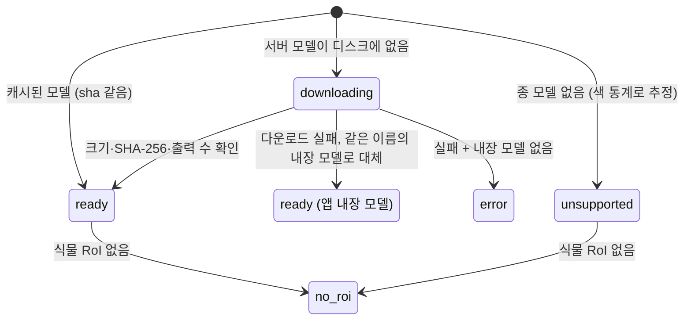

---

## 5. 데이터 모델

SQLite (`backend/data/oojoo.db`). 농장·검출·모델 관련 테이블 중심 (커뮤니티·마켓·가족·결제 테이블은 생략).

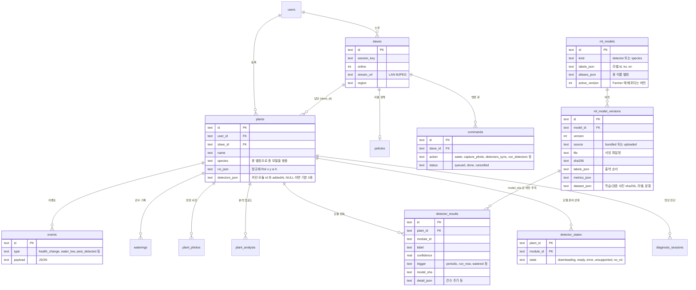

로컬 레지스트리(`ml/registry/<model>/`)는 같은 정보를 파일로 가진다 — `model.json`(= ml_models), `versions/vN/version.json`(= ml_model_versions + 학습 이력·평가), `samples.json` + `samples/<sha256>.jpg`(학습 사진). 서버 `ml_model_versions.dataset_json` 은 업로드된 버전의 사진 목록이고, 사진 파일은 `data/ml/datasets/<model>/<sha256>.jpg`.

---

## 6. 기능 → 파일 찾기

| 기능 | Master | Farmer | 백엔드 | 로컬 도구 |
|---|---|---|---|---|
| 페어링·하트비트 | `ui/PairingScreen.kt` | `ui/PairingScreen.kt`, `FarmerEngine.start` | `routes/pairing.js` | |
| 원격 명령 (SSE) | `network/ApiService.sendCommand` | `FarmerEngine.startSSE / handleSSECommand / pollCommands` | `routes/commands.js` | |
| 검출 모듈 추가·삭제 | `ui/DetectorModules.kt`, `PlantListScreen`, `PlantDetailScreen` | `detect/DetectorManager.sync` | `routes/detectors.js`, `lib/detectors.js` | |
| 모델 다운로드·검증 | | `detect/ModelStore.kt` | `GET /api/detectors/models/:file` | |
| RoI 판독 회차 | `ui/RoiEditorScreen.kt` (RoI 지정) | `FarmerEngine.roiMonitorLoop / runRoiMonitoring / handleRoiResult`, `detect/DetectorLogic.kt` | `routes/detectors.js` results·state | |
| 관수 주기 | 상세 카드 `WateringLines` | `WateringCycleTracker`, `FarmerEngine.attemptWater` | `wateringCycle()` in `routes/detectors.js` | |
| 이벤트 통계 | `ui/EventStats.kt` | `postEventSafe`, 오프라인 큐 | `routes/events.js` (`?days=N`) | |
| 성장 사진첩·클립 | `ui/GrowthAlbum.kt`, `PlantDetailScreen.GrowthClipCard` | `album/PlantAlbum`, `vision/GrowthClipRenderer` | `routes/photos.js`, `routes/videos.js` | |
| 실시간 카메라 | `ui/LiveCameraScreen.kt` | `service/MjpegStreamer`, `FarmerEngine.startLiveRelay` | `routes/live.js` | |
| 모델 학습 | | | | `lib/train.js`, `lib/worker.js`, `lib/jobs.js` (연산: `backend/src/ml/ojp1.js`) |
| 모델 업로드·배포 | | | `routes/models.js`, `ml/registry.js` | `lib/remote.js uploadVersion` |
| 현장 성능·재학습 신호 | | | `ml/stats.js` | `server.mjs localHealth` |
| GitHub 올리기 | | | | `lib/git.js publish` |

### 테스트가 지키는 경계

| 경계 | 테스트 |
|---|---|
| Python 학습 ↔ JS forward | `ml/model-manager/test/engine.test.js` (검증 벡터), `simulation/test/species_models.test.js` |
| JS 학습 결과 ↔ Kotlin forward | `android/slave/.../detect/TrainedModelParityTest.kt` (fixture: `scripts/make-ojp1-parity-fixture.mjs`) |
| 서버 응답 ↔ 앱 DTO | `DetectorContractTest.kt`(farmer), `DetectorModulesTest.kt`(master) — 실제 백엔드로 만든 fixture |
| 검출 모듈 API | `backend/test/detectors.test.js` |
| 릴리스 업로드·배포 | `backend/test/model_releases.test.js` |
| 로컬 도구 전체 흐름 | `ml/model-manager/test/local.test.js` (실제 백엔드 + 임시 git 저장소) |
| Farmer 판독 계획·주기·스로틀 | `DetectorLogicTest.kt`, `ModelStoreTest.kt` |

---

자동 생성 그래프 다시 만들기: `node scripts/code-graph.mjs` (확인만: `--check`)
