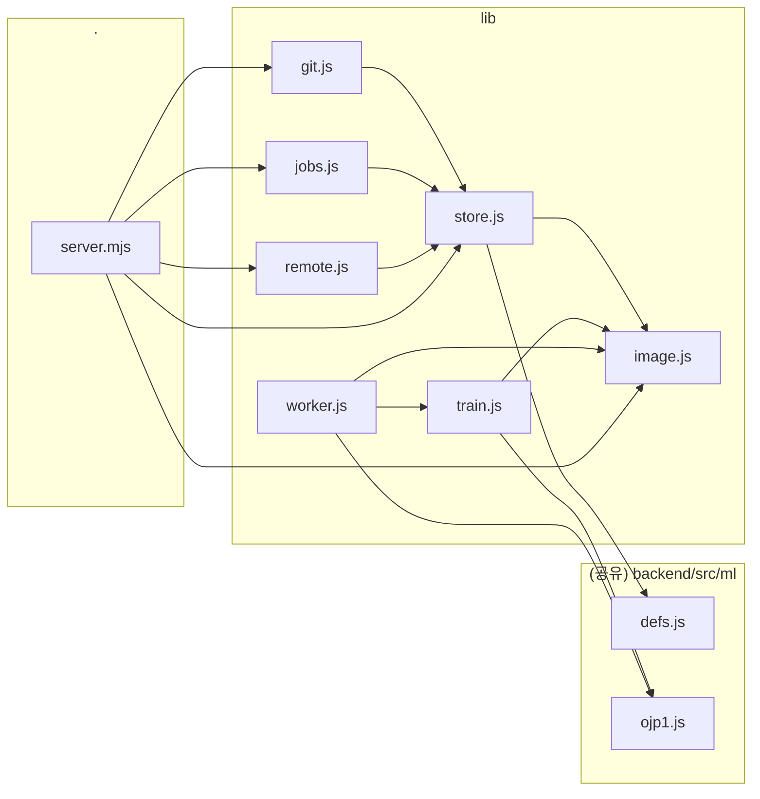
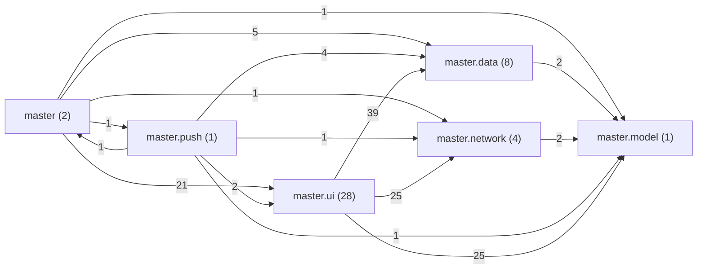
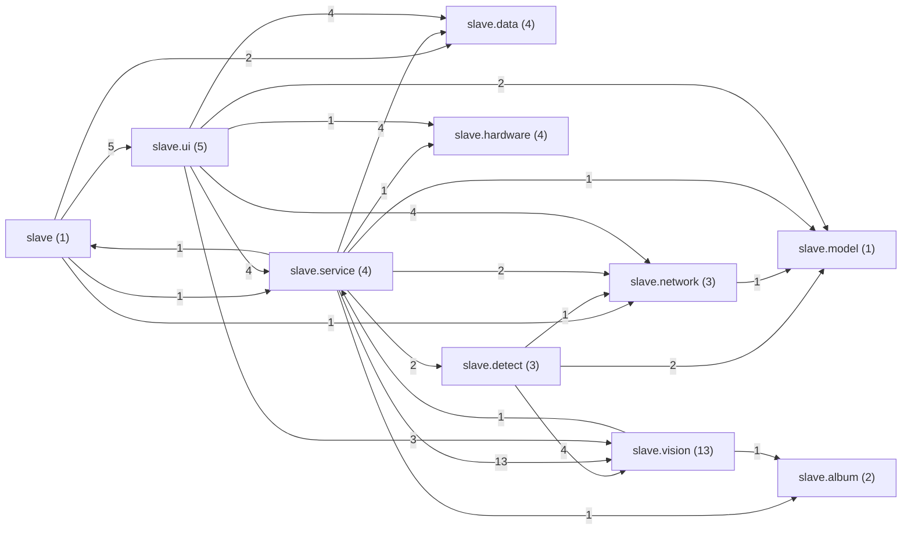

# 코드 그래프 (자동 생성)

> **이 파일은 `node scripts/code-graph.mjs` 가 소스에서 만든다 — 직접 고치지 말 것.**
> 사람이 정리한 흐름·데이터 모델은 [README_kor.md](README_kor.md). English: [generated.md](generated.md)

| 그래프 | 규모 |
|---|---|
| 백엔드 모듈 | 43 모듈, import 45개 (db.js 로 가는 것·app.js 라우터 마운트 제외) |
| 로컬 model-manager 모듈 | 10 모듈, import 15개 |
| Master 앱 | Kotlin 44 파일, 파일 간 참조 192개 |
| Farmer 앱 | Kotlin 40 파일, 파일 간 참조 97개 |
| API 지도 | 백엔드 라우트 125개, 앱 → 라우트 매칭 실패 0개 |

## 1. 백엔드

### 백엔드 (backend/src)

`db.js`(SQLite 연결·스키마)는 거의 모든 모듈이 import 하고, `app.js` 는 모든 `routes/*.js` 를 `/api/<이름>` 에 마운트한다 — 이 두 가지 화살표는 생략했다 (마운트 경로는 §4 API 지도).

```mermaid
flowchart LR
  subgraph g_backend__["."]
    backend_src_app_js["app.js"]
    backend_src_db_js["db.js"]
    backend_src_server_js["server.js"]
  end
  subgraph g_backend_lib["lib"]
    backend_src_lib_communityMedia_js["communityMedia.js"]
    backend_src_lib_detectors_js["detectors.js"]
    backend_src_lib_household_js["household.js"]
    backend_src_lib_marketSeed_js["marketSeed.js"]
    backend_src_lib_pg_js["pg.js"]
    backend_src_lib_push_js["push.js"]
    backend_src_lib_sweeper_js["sweeper.js"]
    backend_src_lib_validate_js["validate.js"]
    backend_src_lib_wateringFactor_js["wateringFactor.js"]
  end
  subgraph g_backend_middleware["middleware"]
    backend_src_middleware_auth_js["auth.js"]
  end
  subgraph g_backend_ml["ml"]
    backend_src_ml_defs_js["defs.js"]
    backend_src_ml_ojp1_js["ojp1.js"]
    backend_src_ml_registry_js["registry.js"]
    backend_src_ml_stats_js["stats.js"]
  end
  subgraph g_backend_routes["routes"]
    backend_src_routes_admin_js["admin.js"]
    backend_src_routes_analysis_js["analysis.js"]
    backend_src_routes_commands_js["commands.js"]
    backend_src_routes_community_js["community.js"]
    backend_src_routes_crash_js["crash.js"]
    backend_src_routes_detectors_js["detectors.js"]
    backend_src_routes_diagnosis_js["diagnosis.js"]
    backend_src_routes_events_js["events.js"]
    backend_src_routes_harvests_js["harvests.js"]
    backend_src_routes_household_js["household.js"]
    backend_src_routes_live_js["live.js"]
    backend_src_routes_market_js["market.js"]
    backend_src_routes_messages_js["messages.js"]
    backend_src_routes_models_js["models.js"]
    backend_src_routes_notifications_js["notifications.js"]
    backend_src_routes_pairing_js["pairing.js"]
    backend_src_routes_payments_js["payments.js"]
    backend_src_routes_photos_js["photos.js"]
    backend_src_routes_plants_js["plants.js"]
    backend_src_routes_policy_js["policy.js"]
    backend_src_routes_report_js["report.js"]
    backend_src_routes_subscription_js["subscription.js"]
    backend_src_routes_users_js["users.js"]
    backend_src_routes_videos_js["videos.js"]
    backend_src_routes_watering_js["watering.js"]
    backend_src_routes_weather_js["weather.js"]
  end
  backend_src_db_js --> backend_src_lib_marketSeed_js
  backend_src_lib_detectors_js --> backend_src_ml_registry_js
  backend_src_lib_push_js --> backend_src_lib_household_js
  backend_src_ml_registry_js --> backend_src_ml_defs_js
  backend_src_ml_stats_js --> backend_src_ml_registry_js
  backend_src_ml_stats_js --> backend_src_lib_detectors_js
  backend_src_routes_analysis_js --> backend_src_middleware_auth_js
  backend_src_routes_commands_js --> backend_src_middleware_auth_js
  backend_src_routes_commands_js --> backend_src_lib_validate_js
  backend_src_routes_community_js --> backend_src_lib_validate_js
  backend_src_routes_community_js --> backend_src_lib_communityMedia_js
  backend_src_routes_detectors_js --> backend_src_middleware_auth_js
  backend_src_routes_detectors_js --> backend_src_routes_commands_js
  backend_src_routes_detectors_js --> backend_src_lib_detectors_js
  backend_src_routes_diagnosis_js --> backend_src_middleware_auth_js
  backend_src_routes_diagnosis_js --> backend_src_routes_commands_js
  backend_src_routes_events_js --> backend_src_middleware_auth_js
  backend_src_routes_events_js --> backend_src_routes_commands_js
  backend_src_routes_events_js --> backend_src_lib_push_js
  backend_src_routes_events_js --> backend_src_lib_validate_js
  backend_src_routes_household_js --> backend_src_lib_household_js
  backend_src_routes_live_js --> backend_src_middleware_auth_js
  backend_src_routes_market_js --> backend_src_lib_marketSeed_js
  backend_src_routes_market_js --> backend_src_lib_pg_js
  backend_src_routes_models_js --> backend_src_ml_registry_js
  backend_src_routes_models_js --> backend_src_ml_defs_js
  backend_src_routes_models_js --> backend_src_ml_ojp1_js
  backend_src_routes_models_js --> backend_src_ml_stats_js
  backend_src_routes_models_js --> backend_src_routes_detectors_js
  backend_src_routes_notifications_js --> backend_src_lib_household_js
  backend_src_routes_pairing_js --> backend_src_middleware_auth_js
  backend_src_routes_pairing_js --> backend_src_lib_household_js
  backend_src_routes_pairing_js --> backend_src_routes_subscription_js
  backend_src_routes_payments_js --> backend_src_lib_pg_js
  backend_src_routes_photos_js --> backend_src_middleware_auth_js
  backend_src_routes_photos_js --> backend_src_lib_household_js
  backend_src_routes_photos_js --> backend_src_routes_commands_js
  backend_src_routes_plants_js --> backend_src_lib_household_js
  backend_src_routes_plants_js --> backend_src_lib_detectors_js
  backend_src_routes_plants_js --> backend_src_routes_detectors_js
  backend_src_routes_videos_js --> backend_src_middleware_auth_js
  backend_src_routes_videos_js --> backend_src_routes_commands_js
  backend_src_routes_watering_js --> backend_src_middleware_auth_js
  backend_src_routes_watering_js --> backend_src_lib_validate_js
  backend_src_routes_weather_js --> backend_src_lib_wateringFactor_js
```



## 2. 로컬 model-manager

### 로컬 model-manager (ml/model-manager)

"(공유)" 그룹은 로컬 도구가 그대로 가져다 쓰는 백엔드 모듈 — 모델 연산(`ojp1.js`)과 내장 모델 정의(`defs.js`).



## 3. Android 앱

Kotlin 은 같은 패키지끼리 import 없이 쓰므로, **다른 파일의 최상위 선언(class / object / interface / fun) 이름을 참조하면** 의존으로 본다 (주석·문자열 제외).

### Master 앱 — 패키지

화살표 숫자 = 그 패키지에서 대상 패키지의 파일을 참조하는 (파일→파일) 관계 수. 괄호 = 파일 수.



### Master 앱 — 파일

★ 허브 파일(대부분의 파일이 참조 — 화살표 생략): `Models.kt` (31개 파일이 참조), `Session.kt` (19개 파일이 참조), `ApiClient.kt` (26개 파일이 참조), `Theme.kt` (26개 파일이 참조)

```mermaid
flowchart LR
  subgraph master_s__root_["(root)"]
    android_master_app_src_main_java_com_oojoo_farm_master_MainActivity_kt["MainActivity"]
    android_master_app_src_main_java_com_oojoo_farm_master_OojooApp_kt["OojooApp"]
  end
  subgraph master_s_data["data"]
    android_master_app_src_main_java_com_oojoo_farm_master_data_AppLocale_kt["AppLocale"]
    android_master_app_src_main_java_com_oojoo_farm_master_data_Cart_kt["Cart"]
    android_master_app_src_main_java_com_oojoo_farm_master_data_FirebaseCfg_kt["FirebaseCfg"]
    android_master_app_src_main_java_com_oojoo_farm_master_data_LocationHelper_kt["LocationHelper"]
    android_master_app_src_main_java_com_oojoo_farm_master_data_MediaPrep_kt["MediaPrep"]
    android_master_app_src_main_java_com_oojoo_farm_master_data_Prefs_kt["Prefs"]
    android_master_app_src_main_java_com_oojoo_farm_master_data_ServerConfig_kt["ServerConfig"]
    android_master_app_src_main_java_com_oojoo_farm_master_data_Session_kt["Session ★"]
  end
  subgraph master_s_model["model"]
    android_master_app_src_main_java_com_oojoo_farm_master_model_Models_kt["Models ★"]
  end
  subgraph master_s_network["network"]
    android_master_app_src_main_java_com_oojoo_farm_master_network_ApiClient_kt["ApiClient ★"]
    android_master_app_src_main_java_com_oojoo_farm_master_network_ApiService_kt["ApiService"]
    android_master_app_src_main_java_com_oojoo_farm_master_network_MediaUploader_kt["MediaUploader"]
    android_master_app_src_main_java_com_oojoo_farm_master_network_ServerEndpoint_kt["ServerEndpoint"]
  end
  subgraph master_s_push["push"]
    android_master_app_src_main_java_com_oojoo_farm_master_push_FcmService_kt["FcmService"]
  end
  subgraph master_s_ui["ui"]
    android_master_app_src_main_java_com_oojoo_farm_master_ui_AuthScreen_kt["AuthScreen"]
    android_master_app_src_main_java_com_oojoo_farm_master_ui_CommunityMedia_kt["CommunityMedia"]
    android_master_app_src_main_java_com_oojoo_farm_master_ui_CommunityScreen_kt["CommunityScreen"]
    android_master_app_src_main_java_com_oojoo_farm_master_ui_DetectorModules_kt["DetectorModules"]
    android_master_app_src_main_java_com_oojoo_farm_master_ui_DiagnosisReviewScreen_kt["DiagnosisReviewScreen"]
    android_master_app_src_main_java_com_oojoo_farm_master_ui_EventStats_kt["EventStats"]
    android_master_app_src_main_java_com_oojoo_farm_master_ui_FamilyScreen_kt["FamilyScreen"]
    android_master_app_src_main_java_com_oojoo_farm_master_ui_FarmGrid_kt["FarmGrid"]
    android_master_app_src_main_java_com_oojoo_farm_master_ui_FarmerListScreen_kt["FarmerListScreen"]
    android_master_app_src_main_java_com_oojoo_farm_master_ui_FilamentViewer_kt["FilamentViewer"]
    android_master_app_src_main_java_com_oojoo_farm_master_ui_GalleryScreen_kt["GalleryScreen"]
    android_master_app_src_main_java_com_oojoo_farm_master_ui_GrowthAlbum_kt["GrowthAlbum"]
    android_master_app_src_main_java_com_oojoo_farm_master_ui_HomeScreen_kt["HomeScreen"]
    android_master_app_src_main_java_com_oojoo_farm_master_ui_LiveCameraScreen_kt["LiveCameraScreen"]
    android_master_app_src_main_java_com_oojoo_farm_master_ui_LocalizedMessages_kt["LocalizedMessages"]
    android_master_app_src_main_java_com_oojoo_farm_master_ui_MarketScreen_kt["MarketScreen"]
    android_master_app_src_main_java_com_oojoo_farm_master_ui_MessagesScreen_kt["MessagesScreen"]
    android_master_app_src_main_java_com_oojoo_farm_master_ui_NotificationScreen_kt["NotificationScreen"]
    android_master_app_src_main_java_com_oojoo_farm_master_ui_PairingScreen_kt["PairingScreen"]
    android_master_app_src_main_java_com_oojoo_farm_master_ui_PlantDetailScreen_kt["PlantDetailScreen"]
    android_master_app_src_main_java_com_oojoo_farm_master_ui_PlantListScreen_kt["PlantListScreen"]
    android_master_app_src_main_java_com_oojoo_farm_master_ui_PlantRegistrationScreen_kt["PlantRegistrationScreen"]
    android_master_app_src_main_java_com_oojoo_farm_master_ui_ProfileScreen_kt["ProfileScreen"]
    android_master_app_src_main_java_com_oojoo_farm_master_ui_ReportScreen_kt["ReportScreen"]
    android_master_app_src_main_java_com_oojoo_farm_master_ui_RoiEditorScreen_kt["RoiEditorScreen"]
    android_master_app_src_main_java_com_oojoo_farm_master_ui_SubscriptionScreen_kt["SubscriptionScreen"]
    android_master_app_src_main_java_com_oojoo_farm_master_ui_Theme_kt["Theme ★"]
    android_master_app_src_main_java_com_oojoo_farm_master_ui_ThemeEditorScreen_kt["ThemeEditorScreen"]
  end
  android_master_app_src_main_java_com_oojoo_farm_master_MainActivity_kt --> android_master_app_src_main_java_com_oojoo_farm_master_data_AppLocale_kt
  android_master_app_src_main_java_com_oojoo_farm_master_MainActivity_kt --> android_master_app_src_main_java_com_oojoo_farm_master_data_Prefs_kt
  android_master_app_src_main_java_com_oojoo_farm_master_MainActivity_kt --> android_master_app_src_main_java_com_oojoo_farm_master_push_FcmService_kt
  android_master_app_src_main_java_com_oojoo_farm_master_MainActivity_kt --> android_master_app_src_main_java_com_oojoo_farm_master_ui_AuthScreen_kt
  android_master_app_src_main_java_com_oojoo_farm_master_MainActivity_kt --> android_master_app_src_main_java_com_oojoo_farm_master_ui_CommunityScreen_kt
  android_master_app_src_main_java_com_oojoo_farm_master_MainActivity_kt --> android_master_app_src_main_java_com_oojoo_farm_master_ui_DiagnosisReviewScreen_kt
  android_master_app_src_main_java_com_oojoo_farm_master_MainActivity_kt --> android_master_app_src_main_java_com_oojoo_farm_master_ui_FamilyScreen_kt
  android_master_app_src_main_java_com_oojoo_farm_master_MainActivity_kt --> android_master_app_src_main_java_com_oojoo_farm_master_ui_FarmerListScreen_kt
  android_master_app_src_main_java_com_oojoo_farm_master_MainActivity_kt --> android_master_app_src_main_java_com_oojoo_farm_master_ui_GalleryScreen_kt
  android_master_app_src_main_java_com_oojoo_farm_master_MainActivity_kt --> android_master_app_src_main_java_com_oojoo_farm_master_ui_HomeScreen_kt
  android_master_app_src_main_java_com_oojoo_farm_master_MainActivity_kt --> android_master_app_src_main_java_com_oojoo_farm_master_ui_LiveCameraScreen_kt
  android_master_app_src_main_java_com_oojoo_farm_master_MainActivity_kt --> android_master_app_src_main_java_com_oojoo_farm_master_ui_MarketScreen_kt
  android_master_app_src_main_java_com_oojoo_farm_master_MainActivity_kt --> android_master_app_src_main_java_com_oojoo_farm_master_ui_MessagesScreen_kt
  android_master_app_src_main_java_com_oojoo_farm_master_MainActivity_kt --> android_master_app_src_main_java_com_oojoo_farm_master_ui_NotificationScreen_kt
  android_master_app_src_main_java_com_oojoo_farm_master_MainActivity_kt --> android_master_app_src_main_java_com_oojoo_farm_master_ui_PairingScreen_kt
  android_master_app_src_main_java_com_oojoo_farm_master_MainActivity_kt --> android_master_app_src_main_java_com_oojoo_farm_master_ui_PlantDetailScreen_kt
  android_master_app_src_main_java_com_oojoo_farm_master_MainActivity_kt --> android_master_app_src_main_java_com_oojoo_farm_master_ui_PlantListScreen_kt
  android_master_app_src_main_java_com_oojoo_farm_master_MainActivity_kt --> android_master_app_src_main_java_com_oojoo_farm_master_ui_PlantRegistrationScreen_kt
  android_master_app_src_main_java_com_oojoo_farm_master_MainActivity_kt --> android_master_app_src_main_java_com_oojoo_farm_master_ui_ProfileScreen_kt
  android_master_app_src_main_java_com_oojoo_farm_master_MainActivity_kt --> android_master_app_src_main_java_com_oojoo_farm_master_ui_ReportScreen_kt
  android_master_app_src_main_java_com_oojoo_farm_master_MainActivity_kt --> android_master_app_src_main_java_com_oojoo_farm_master_ui_RoiEditorScreen_kt
  android_master_app_src_main_java_com_oojoo_farm_master_MainActivity_kt --> android_master_app_src_main_java_com_oojoo_farm_master_ui_SubscriptionScreen_kt
  android_master_app_src_main_java_com_oojoo_farm_master_MainActivity_kt --> android_master_app_src_main_java_com_oojoo_farm_master_ui_ThemeEditorScreen_kt
  android_master_app_src_main_java_com_oojoo_farm_master_OojooApp_kt --> android_master_app_src_main_java_com_oojoo_farm_master_data_AppLocale_kt
  android_master_app_src_main_java_com_oojoo_farm_master_OojooApp_kt --> android_master_app_src_main_java_com_oojoo_farm_master_data_FirebaseCfg_kt
  android_master_app_src_main_java_com_oojoo_farm_master_data_AppLocale_kt --> android_master_app_src_main_java_com_oojoo_farm_master_data_Prefs_kt
  android_master_app_src_main_java_com_oojoo_farm_master_data_Prefs_kt --> android_master_app_src_main_java_com_oojoo_farm_master_data_AppLocale_kt
  android_master_app_src_main_java_com_oojoo_farm_master_data_Prefs_kt --> android_master_app_src_main_java_com_oojoo_farm_master_data_ServerConfig_kt
  android_master_app_src_main_java_com_oojoo_farm_master_data_Session_kt --> android_master_app_src_main_java_com_oojoo_farm_master_data_Prefs_kt
  android_master_app_src_main_java_com_oojoo_farm_master_network_ApiClient_kt --> android_master_app_src_main_java_com_oojoo_farm_master_network_ApiService_kt
  android_master_app_src_main_java_com_oojoo_farm_master_network_ApiClient_kt --> android_master_app_src_main_java_com_oojoo_farm_master_network_ServerEndpoint_kt
  android_master_app_src_main_java_com_oojoo_farm_master_push_FcmService_kt --> android_master_app_src_main_java_com_oojoo_farm_master_MainActivity_kt
  android_master_app_src_main_java_com_oojoo_farm_master_push_FcmService_kt --> android_master_app_src_main_java_com_oojoo_farm_master_data_AppLocale_kt
  android_master_app_src_main_java_com_oojoo_farm_master_push_FcmService_kt --> android_master_app_src_main_java_com_oojoo_farm_master_data_FirebaseCfg_kt
  android_master_app_src_main_java_com_oojoo_farm_master_push_FcmService_kt --> android_master_app_src_main_java_com_oojoo_farm_master_data_Prefs_kt
  android_master_app_src_main_java_com_oojoo_farm_master_push_FcmService_kt --> android_master_app_src_main_java_com_oojoo_farm_master_ui_NotificationScreen_kt
  android_master_app_src_main_java_com_oojoo_farm_master_push_FcmService_kt --> android_master_app_src_main_java_com_oojoo_farm_master_ui_PlantDetailScreen_kt
  android_master_app_src_main_java_com_oojoo_farm_master_ui_AuthScreen_kt --> android_master_app_src_main_java_com_oojoo_farm_master_data_LocationHelper_kt
  android_master_app_src_main_java_com_oojoo_farm_master_ui_AuthScreen_kt --> android_master_app_src_main_java_com_oojoo_farm_master_data_Prefs_kt
  android_master_app_src_main_java_com_oojoo_farm_master_ui_CommunityMedia_kt --> android_master_app_src_main_java_com_oojoo_farm_master_data_MediaPrep_kt
  android_master_app_src_main_java_com_oojoo_farm_master_ui_CommunityMedia_kt --> android_master_app_src_main_java_com_oojoo_farm_master_ui_GrowthAlbum_kt
  android_master_app_src_main_java_com_oojoo_farm_master_ui_CommunityScreen_kt --> android_master_app_src_main_java_com_oojoo_farm_master_data_AppLocale_kt
  android_master_app_src_main_java_com_oojoo_farm_master_ui_CommunityScreen_kt --> android_master_app_src_main_java_com_oojoo_farm_master_data_LocationHelper_kt
  android_master_app_src_main_java_com_oojoo_farm_master_ui_CommunityScreen_kt --> android_master_app_src_main_java_com_oojoo_farm_master_data_MediaPrep_kt
  android_master_app_src_main_java_com_oojoo_farm_master_ui_CommunityScreen_kt --> android_master_app_src_main_java_com_oojoo_farm_master_network_MediaUploader_kt
  android_master_app_src_main_java_com_oojoo_farm_master_ui_CommunityScreen_kt --> android_master_app_src_main_java_com_oojoo_farm_master_ui_CommunityMedia_kt
  android_master_app_src_main_java_com_oojoo_farm_master_ui_CommunityScreen_kt --> android_master_app_src_main_java_com_oojoo_farm_master_ui_LocalizedMessages_kt
  android_master_app_src_main_java_com_oojoo_farm_master_ui_DetectorModules_kt --> android_master_app_src_main_java_com_oojoo_farm_master_ui_EventStats_kt
  android_master_app_src_main_java_com_oojoo_farm_master_ui_DetectorModules_kt --> android_master_app_src_main_java_com_oojoo_farm_master_ui_GrowthAlbum_kt
  android_master_app_src_main_java_com_oojoo_farm_master_ui_DiagnosisReviewScreen_kt --> android_master_app_src_main_java_com_oojoo_farm_master_data_AppLocale_kt
  android_master_app_src_main_java_com_oojoo_farm_master_ui_DiagnosisReviewScreen_kt --> android_master_app_src_main_java_com_oojoo_farm_master_ui_LocalizedMessages_kt
  android_master_app_src_main_java_com_oojoo_farm_master_ui_EventStats_kt --> android_master_app_src_main_java_com_oojoo_farm_master_ui_GrowthAlbum_kt
  android_master_app_src_main_java_com_oojoo_farm_master_ui_EventStats_kt --> android_master_app_src_main_java_com_oojoo_farm_master_ui_PlantDetailScreen_kt
  android_master_app_src_main_java_com_oojoo_farm_master_ui_FarmGrid_kt --> android_master_app_src_main_java_com_oojoo_farm_master_data_Prefs_kt
  android_master_app_src_main_java_com_oojoo_farm_master_ui_FarmerListScreen_kt --> android_master_app_src_main_java_com_oojoo_farm_master_ui_FilamentViewer_kt
  android_master_app_src_main_java_com_oojoo_farm_master_ui_FarmerListScreen_kt --> android_master_app_src_main_java_com_oojoo_farm_master_ui_LocalizedMessages_kt
  android_master_app_src_main_java_com_oojoo_farm_master_ui_FilamentViewer_kt --> android_master_app_src_main_java_com_oojoo_farm_master_data_Prefs_kt
  android_master_app_src_main_java_com_oojoo_farm_master_ui_FilamentViewer_kt --> android_master_app_src_main_java_com_oojoo_farm_master_ui_FarmGrid_kt
  android_master_app_src_main_java_com_oojoo_farm_master_ui_GalleryScreen_kt --> android_master_app_src_main_java_com_oojoo_farm_master_data_Prefs_kt
  android_master_app_src_main_java_com_oojoo_farm_master_ui_GalleryScreen_kt --> android_master_app_src_main_java_com_oojoo_farm_master_ui_FilamentViewer_kt
  android_master_app_src_main_java_com_oojoo_farm_master_ui_GalleryScreen_kt --> android_master_app_src_main_java_com_oojoo_farm_master_ui_RoiEditorScreen_kt
  android_master_app_src_main_java_com_oojoo_farm_master_ui_HomeScreen_kt --> android_master_app_src_main_java_com_oojoo_farm_master_data_AppLocale_kt
  android_master_app_src_main_java_com_oojoo_farm_master_ui_HomeScreen_kt --> android_master_app_src_main_java_com_oojoo_farm_master_data_LocationHelper_kt
  android_master_app_src_main_java_com_oojoo_farm_master_ui_HomeScreen_kt --> android_master_app_src_main_java_com_oojoo_farm_master_data_Prefs_kt
  android_master_app_src_main_java_com_oojoo_farm_master_ui_HomeScreen_kt --> android_master_app_src_main_java_com_oojoo_farm_master_ui_FilamentViewer_kt
  android_master_app_src_main_java_com_oojoo_farm_master_ui_LiveCameraScreen_kt --> android_master_app_src_main_java_com_oojoo_farm_master_data_AppLocale_kt
  android_master_app_src_main_java_com_oojoo_farm_master_ui_LiveCameraScreen_kt --> android_master_app_src_main_java_com_oojoo_farm_master_data_Prefs_kt
  android_master_app_src_main_java_com_oojoo_farm_master_ui_LocalizedMessages_kt --> android_master_app_src_main_java_com_oojoo_farm_master_data_AppLocale_kt
  android_master_app_src_main_java_com_oojoo_farm_master_ui_MarketScreen_kt --> android_master_app_src_main_java_com_oojoo_farm_master_data_Cart_kt
  android_master_app_src_main_java_com_oojoo_farm_master_ui_MessagesScreen_kt --> android_master_app_src_main_java_com_oojoo_farm_master_ui_LocalizedMessages_kt
  android_master_app_src_main_java_com_oojoo_farm_master_ui_NotificationScreen_kt --> android_master_app_src_main_java_com_oojoo_farm_master_ui_PlantDetailScreen_kt
  android_master_app_src_main_java_com_oojoo_farm_master_ui_PlantDetailScreen_kt --> android_master_app_src_main_java_com_oojoo_farm_master_data_AppLocale_kt
  android_master_app_src_main_java_com_oojoo_farm_master_ui_PlantDetailScreen_kt --> android_master_app_src_main_java_com_oojoo_farm_master_data_Prefs_kt
  android_master_app_src_main_java_com_oojoo_farm_master_ui_PlantDetailScreen_kt --> android_master_app_src_main_java_com_oojoo_farm_master_ui_DetectorModules_kt
  android_master_app_src_main_java_com_oojoo_farm_master_ui_PlantDetailScreen_kt --> android_master_app_src_main_java_com_oojoo_farm_master_ui_EventStats_kt
  android_master_app_src_main_java_com_oojoo_farm_master_ui_PlantDetailScreen_kt --> android_master_app_src_main_java_com_oojoo_farm_master_ui_FarmGrid_kt
  android_master_app_src_main_java_com_oojoo_farm_master_ui_PlantDetailScreen_kt --> android_master_app_src_main_java_com_oojoo_farm_master_ui_FilamentViewer_kt
  android_master_app_src_main_java_com_oojoo_farm_master_ui_PlantDetailScreen_kt --> android_master_app_src_main_java_com_oojoo_farm_master_ui_GrowthAlbum_kt
  android_master_app_src_main_java_com_oojoo_farm_master_ui_PlantDetailScreen_kt --> android_master_app_src_main_java_com_oojoo_farm_master_ui_LocalizedMessages_kt
  android_master_app_src_main_java_com_oojoo_farm_master_ui_PlantListScreen_kt --> android_master_app_src_main_java_com_oojoo_farm_master_ui_DetectorModules_kt
  android_master_app_src_main_java_com_oojoo_farm_master_ui_PlantListScreen_kt --> android_master_app_src_main_java_com_oojoo_farm_master_ui_FilamentViewer_kt
  android_master_app_src_main_java_com_oojoo_farm_master_ui_PlantListScreen_kt --> android_master_app_src_main_java_com_oojoo_farm_master_ui_LocalizedMessages_kt
  android_master_app_src_main_java_com_oojoo_farm_master_ui_PlantRegistrationScreen_kt --> android_master_app_src_main_java_com_oojoo_farm_master_data_Prefs_kt
  android_master_app_src_main_java_com_oojoo_farm_master_ui_PlantRegistrationScreen_kt --> android_master_app_src_main_java_com_oojoo_farm_master_ui_FarmGrid_kt
  android_master_app_src_main_java_com_oojoo_farm_master_ui_PlantRegistrationScreen_kt --> android_master_app_src_main_java_com_oojoo_farm_master_ui_FilamentViewer_kt
  android_master_app_src_main_java_com_oojoo_farm_master_ui_ProfileScreen_kt --> android_master_app_src_main_java_com_oojoo_farm_master_ui_LocalizedMessages_kt
  android_master_app_src_main_java_com_oojoo_farm_master_ui_SubscriptionScreen_kt --> android_master_app_src_main_java_com_oojoo_farm_master_ui_LocalizedMessages_kt
  android_master_app_src_main_java_com_oojoo_farm_master_ui_ThemeEditorScreen_kt --> android_master_app_src_main_java_com_oojoo_farm_master_data_AppLocale_kt
  android_master_app_src_main_java_com_oojoo_farm_master_ui_ThemeEditorScreen_kt --> android_master_app_src_main_java_com_oojoo_farm_master_data_Prefs_kt
  android_master_app_src_main_java_com_oojoo_farm_master_ui_ThemeEditorScreen_kt --> android_master_app_src_main_java_com_oojoo_farm_master_network_ServerEndpoint_kt
```

### Farmer 앱 — 패키지

화살표 숫자 = 그 패키지에서 대상 패키지의 파일을 참조하는 (파일→파일) 관계 수. 괄호 = 파일 수.



### Farmer 앱 — 파일

★ 허브 파일(대부분의 파일이 참조 — 화살표 생략): 없음

```mermaid
flowchart LR
  subgraph farmer_s__root_["(root)"]
    android_slave_app_src_main_java_com_oojoo_farm_slave_MainActivity_kt["MainActivity"]
  end
  subgraph farmer_s_album["album"]
    android_slave_app_src_main_java_com_oojoo_farm_slave_album_GalleryPublisher_kt["GalleryPublisher"]
    android_slave_app_src_main_java_com_oojoo_farm_slave_album_PlantAlbum_kt["PlantAlbum"]
  end
  subgraph farmer_s_data["data"]
    android_slave_app_src_main_java_com_oojoo_farm_slave_data_AppLocale_kt["AppLocale"]
    android_slave_app_src_main_java_com_oojoo_farm_slave_data_LocationUtil_kt["LocationUtil"]
    android_slave_app_src_main_java_com_oojoo_farm_slave_data_Prefs_kt["Prefs"]
    android_slave_app_src_main_java_com_oojoo_farm_slave_data_ServerConfig_kt["ServerConfig"]
  end
  subgraph farmer_s_detect["detect"]
    android_slave_app_src_main_java_com_oojoo_farm_slave_detect_DetectorLogic_kt["DetectorLogic"]
    android_slave_app_src_main_java_com_oojoo_farm_slave_detect_DetectorManager_kt["DetectorManager"]
    android_slave_app_src_main_java_com_oojoo_farm_slave_detect_ModelStore_kt["ModelStore"]
  end
  subgraph farmer_s_hardware["hardware"]
    android_slave_app_src_main_java_com_oojoo_farm_slave_hardware_BleHardwareController_kt["BleHardwareController"]
    android_slave_app_src_main_java_com_oojoo_farm_slave_hardware_Hardware_kt["Hardware"]
    android_slave_app_src_main_java_com_oojoo_farm_slave_hardware_HardwareController_kt["HardwareController"]
    android_slave_app_src_main_java_com_oojoo_farm_slave_hardware_MockHardwareController_kt["MockHardwareController"]
  end
  subgraph farmer_s_model["model"]
    android_slave_app_src_main_java_com_oojoo_farm_slave_model_Models_kt["Models"]
  end
  subgraph farmer_s_network["network"]
    android_slave_app_src_main_java_com_oojoo_farm_slave_network_ApiClient_kt["ApiClient"]
    android_slave_app_src_main_java_com_oojoo_farm_slave_network_ApiService_kt["ApiService"]
    android_slave_app_src_main_java_com_oojoo_farm_slave_network_ServerEndpoint_kt["ServerEndpoint"]
  end
  subgraph farmer_s_service["service"]
    android_slave_app_src_main_java_com_oojoo_farm_slave_service_BootReceiver_kt["BootReceiver"]
    android_slave_app_src_main_java_com_oojoo_farm_slave_service_FarmerEngine_kt["FarmerEngine"]
    android_slave_app_src_main_java_com_oojoo_farm_slave_service_FarmerService_kt["FarmerService"]
    android_slave_app_src_main_java_com_oojoo_farm_slave_service_MjpegStreamer_kt["MjpegStreamer"]
  end
  subgraph farmer_s_ui["ui"]
    android_slave_app_src_main_java_com_oojoo_farm_slave_ui_DashboardScreen_kt["DashboardScreen"]
    android_slave_app_src_main_java_com_oojoo_farm_slave_ui_PairingScreen_kt["PairingScreen"]
    android_slave_app_src_main_java_com_oojoo_farm_slave_ui_RoiEditorScreen_kt["RoiEditorScreen"]
    android_slave_app_src_main_java_com_oojoo_farm_slave_ui_SettingsScreen_kt["SettingsScreen"]
    android_slave_app_src_main_java_com_oojoo_farm_slave_ui_Theme_kt["Theme"]
  end
  subgraph farmer_s_vision["vision"]
    android_slave_app_src_main_java_com_oojoo_farm_slave_vision_CameraHolder_kt["CameraHolder"]
    android_slave_app_src_main_java_com_oojoo_farm_slave_vision_CameraHost_kt["CameraHost"]
    android_slave_app_src_main_java_com_oojoo_farm_slave_vision_CameraPreview_kt["CameraPreview"]
    android_slave_app_src_main_java_com_oojoo_farm_slave_vision_GrowthClipRenderer_kt["GrowthClipRenderer"]
    android_slave_app_src_main_java_com_oojoo_farm_slave_vision_HealthGradeNet_kt["HealthGradeNet"]
    android_slave_app_src_main_java_com_oojoo_farm_slave_vision_Ojp1_kt["Ojp1"]
    android_slave_app_src_main_java_com_oojoo_farm_slave_vision_OrientationPolicy_kt["OrientationPolicy"]
    android_slave_app_src_main_java_com_oojoo_farm_slave_vision_OrientationUtil_kt["OrientationUtil"]
    android_slave_app_src_main_java_com_oojoo_farm_slave_vision_PestNet_kt["PestNet"]
    android_slave_app_src_main_java_com_oojoo_farm_slave_vision_PlantAnalyzer_kt["PlantAnalyzer"]
    android_slave_app_src_main_java_com_oojoo_farm_slave_vision_PlantHealthNet_kt["PlantHealthNet"]
    android_slave_app_src_main_java_com_oojoo_farm_slave_vision_RoiStore_kt["RoiStore"]
    android_slave_app_src_main_java_com_oojoo_farm_slave_vision_VideoFrameSampler_kt["VideoFrameSampler"]
  end
  android_slave_app_src_main_java_com_oojoo_farm_slave_MainActivity_kt --> android_slave_app_src_main_java_com_oojoo_farm_slave_data_AppLocale_kt
  android_slave_app_src_main_java_com_oojoo_farm_slave_MainActivity_kt --> android_slave_app_src_main_java_com_oojoo_farm_slave_data_Prefs_kt
  android_slave_app_src_main_java_com_oojoo_farm_slave_MainActivity_kt --> android_slave_app_src_main_java_com_oojoo_farm_slave_network_ApiClient_kt
  android_slave_app_src_main_java_com_oojoo_farm_slave_MainActivity_kt --> android_slave_app_src_main_java_com_oojoo_farm_slave_service_FarmerService_kt
  android_slave_app_src_main_java_com_oojoo_farm_slave_MainActivity_kt --> android_slave_app_src_main_java_com_oojoo_farm_slave_ui_DashboardScreen_kt
  android_slave_app_src_main_java_com_oojoo_farm_slave_MainActivity_kt --> android_slave_app_src_main_java_com_oojoo_farm_slave_ui_PairingScreen_kt
  android_slave_app_src_main_java_com_oojoo_farm_slave_MainActivity_kt --> android_slave_app_src_main_java_com_oojoo_farm_slave_ui_RoiEditorScreen_kt
  android_slave_app_src_main_java_com_oojoo_farm_slave_MainActivity_kt --> android_slave_app_src_main_java_com_oojoo_farm_slave_ui_SettingsScreen_kt
  android_slave_app_src_main_java_com_oojoo_farm_slave_MainActivity_kt --> android_slave_app_src_main_java_com_oojoo_farm_slave_ui_Theme_kt
  android_slave_app_src_main_java_com_oojoo_farm_slave_album_PlantAlbum_kt --> android_slave_app_src_main_java_com_oojoo_farm_slave_album_GalleryPublisher_kt
  android_slave_app_src_main_java_com_oojoo_farm_slave_data_AppLocale_kt --> android_slave_app_src_main_java_com_oojoo_farm_slave_data_Prefs_kt
  android_slave_app_src_main_java_com_oojoo_farm_slave_data_Prefs_kt --> android_slave_app_src_main_java_com_oojoo_farm_slave_data_AppLocale_kt
  android_slave_app_src_main_java_com_oojoo_farm_slave_data_Prefs_kt --> android_slave_app_src_main_java_com_oojoo_farm_slave_data_ServerConfig_kt
  android_slave_app_src_main_java_com_oojoo_farm_slave_detect_DetectorManager_kt --> android_slave_app_src_main_java_com_oojoo_farm_slave_detect_DetectorLogic_kt
  android_slave_app_src_main_java_com_oojoo_farm_slave_detect_DetectorManager_kt --> android_slave_app_src_main_java_com_oojoo_farm_slave_detect_ModelStore_kt
  android_slave_app_src_main_java_com_oojoo_farm_slave_detect_DetectorManager_kt --> android_slave_app_src_main_java_com_oojoo_farm_slave_model_Models_kt
  android_slave_app_src_main_java_com_oojoo_farm_slave_detect_DetectorManager_kt --> android_slave_app_src_main_java_com_oojoo_farm_slave_network_ApiClient_kt
  android_slave_app_src_main_java_com_oojoo_farm_slave_detect_DetectorManager_kt --> android_slave_app_src_main_java_com_oojoo_farm_slave_vision_HealthGradeNet_kt
  android_slave_app_src_main_java_com_oojoo_farm_slave_detect_DetectorManager_kt --> android_slave_app_src_main_java_com_oojoo_farm_slave_vision_Ojp1_kt
  android_slave_app_src_main_java_com_oojoo_farm_slave_detect_DetectorManager_kt --> android_slave_app_src_main_java_com_oojoo_farm_slave_vision_PestNet_kt
  android_slave_app_src_main_java_com_oojoo_farm_slave_detect_DetectorManager_kt --> android_slave_app_src_main_java_com_oojoo_farm_slave_vision_PlantHealthNet_kt
  android_slave_app_src_main_java_com_oojoo_farm_slave_detect_ModelStore_kt --> android_slave_app_src_main_java_com_oojoo_farm_slave_model_Models_kt
  android_slave_app_src_main_java_com_oojoo_farm_slave_hardware_BleHardwareController_kt --> android_slave_app_src_main_java_com_oojoo_farm_slave_hardware_HardwareController_kt
  android_slave_app_src_main_java_com_oojoo_farm_slave_hardware_Hardware_kt --> android_slave_app_src_main_java_com_oojoo_farm_slave_hardware_BleHardwareController_kt
  android_slave_app_src_main_java_com_oojoo_farm_slave_hardware_Hardware_kt --> android_slave_app_src_main_java_com_oojoo_farm_slave_hardware_HardwareController_kt
  android_slave_app_src_main_java_com_oojoo_farm_slave_hardware_Hardware_kt --> android_slave_app_src_main_java_com_oojoo_farm_slave_hardware_MockHardwareController_kt
  android_slave_app_src_main_java_com_oojoo_farm_slave_hardware_MockHardwareController_kt --> android_slave_app_src_main_java_com_oojoo_farm_slave_hardware_HardwareController_kt
  android_slave_app_src_main_java_com_oojoo_farm_slave_network_ApiClient_kt --> android_slave_app_src_main_java_com_oojoo_farm_slave_network_ApiService_kt
  android_slave_app_src_main_java_com_oojoo_farm_slave_network_ApiClient_kt --> android_slave_app_src_main_java_com_oojoo_farm_slave_network_ServerEndpoint_kt
  android_slave_app_src_main_java_com_oojoo_farm_slave_network_ApiService_kt --> android_slave_app_src_main_java_com_oojoo_farm_slave_model_Models_kt
  android_slave_app_src_main_java_com_oojoo_farm_slave_service_BootReceiver_kt --> android_slave_app_src_main_java_com_oojoo_farm_slave_data_Prefs_kt
  android_slave_app_src_main_java_com_oojoo_farm_slave_service_BootReceiver_kt --> android_slave_app_src_main_java_com_oojoo_farm_slave_service_FarmerService_kt
  android_slave_app_src_main_java_com_oojoo_farm_slave_service_FarmerEngine_kt --> android_slave_app_src_main_java_com_oojoo_farm_slave_album_PlantAlbum_kt
  android_slave_app_src_main_java_com_oojoo_farm_slave_service_FarmerEngine_kt --> android_slave_app_src_main_java_com_oojoo_farm_slave_data_LocationUtil_kt
  android_slave_app_src_main_java_com_oojoo_farm_slave_service_FarmerEngine_kt --> android_slave_app_src_main_java_com_oojoo_farm_slave_data_Prefs_kt
  android_slave_app_src_main_java_com_oojoo_farm_slave_service_FarmerEngine_kt --> android_slave_app_src_main_java_com_oojoo_farm_slave_detect_DetectorLogic_kt
  android_slave_app_src_main_java_com_oojoo_farm_slave_service_FarmerEngine_kt --> android_slave_app_src_main_java_com_oojoo_farm_slave_detect_DetectorManager_kt
  android_slave_app_src_main_java_com_oojoo_farm_slave_service_FarmerEngine_kt --> android_slave_app_src_main_java_com_oojoo_farm_slave_hardware_Hardware_kt
  android_slave_app_src_main_java_com_oojoo_farm_slave_service_FarmerEngine_kt --> android_slave_app_src_main_java_com_oojoo_farm_slave_model_Models_kt
  android_slave_app_src_main_java_com_oojoo_farm_slave_service_FarmerEngine_kt --> android_slave_app_src_main_java_com_oojoo_farm_slave_network_ApiClient_kt
  android_slave_app_src_main_java_com_oojoo_farm_slave_service_FarmerEngine_kt --> android_slave_app_src_main_java_com_oojoo_farm_slave_service_MjpegStreamer_kt
  android_slave_app_src_main_java_com_oojoo_farm_slave_service_FarmerEngine_kt --> android_slave_app_src_main_java_com_oojoo_farm_slave_vision_CameraHolder_kt
  android_slave_app_src_main_java_com_oojoo_farm_slave_service_FarmerEngine_kt --> android_slave_app_src_main_java_com_oojoo_farm_slave_vision_CameraHost_kt
  android_slave_app_src_main_java_com_oojoo_farm_slave_service_FarmerEngine_kt --> android_slave_app_src_main_java_com_oojoo_farm_slave_vision_GrowthClipRenderer_kt
  android_slave_app_src_main_java_com_oojoo_farm_slave_service_FarmerEngine_kt --> android_slave_app_src_main_java_com_oojoo_farm_slave_vision_HealthGradeNet_kt
  android_slave_app_src_main_java_com_oojoo_farm_slave_service_FarmerEngine_kt --> android_slave_app_src_main_java_com_oojoo_farm_slave_vision_OrientationPolicy_kt
  android_slave_app_src_main_java_com_oojoo_farm_slave_service_FarmerEngine_kt --> android_slave_app_src_main_java_com_oojoo_farm_slave_vision_OrientationUtil_kt
  android_slave_app_src_main_java_com_oojoo_farm_slave_service_FarmerEngine_kt --> android_slave_app_src_main_java_com_oojoo_farm_slave_vision_PestNet_kt
  android_slave_app_src_main_java_com_oojoo_farm_slave_service_FarmerEngine_kt --> android_slave_app_src_main_java_com_oojoo_farm_slave_vision_PlantAnalyzer_kt
  android_slave_app_src_main_java_com_oojoo_farm_slave_service_FarmerEngine_kt --> android_slave_app_src_main_java_com_oojoo_farm_slave_vision_PlantHealthNet_kt
  android_slave_app_src_main_java_com_oojoo_farm_slave_service_FarmerEngine_kt --> android_slave_app_src_main_java_com_oojoo_farm_slave_vision_RoiStore_kt
  android_slave_app_src_main_java_com_oojoo_farm_slave_service_FarmerEngine_kt --> android_slave_app_src_main_java_com_oojoo_farm_slave_vision_VideoFrameSampler_kt
  android_slave_app_src_main_java_com_oojoo_farm_slave_service_FarmerService_kt --> android_slave_app_src_main_java_com_oojoo_farm_slave_MainActivity_kt
  android_slave_app_src_main_java_com_oojoo_farm_slave_service_FarmerService_kt --> android_slave_app_src_main_java_com_oojoo_farm_slave_data_Prefs_kt
  android_slave_app_src_main_java_com_oojoo_farm_slave_service_FarmerService_kt --> android_slave_app_src_main_java_com_oojoo_farm_slave_network_ApiClient_kt
  android_slave_app_src_main_java_com_oojoo_farm_slave_service_FarmerService_kt --> android_slave_app_src_main_java_com_oojoo_farm_slave_service_FarmerEngine_kt
  android_slave_app_src_main_java_com_oojoo_farm_slave_service_FarmerService_kt --> android_slave_app_src_main_java_com_oojoo_farm_slave_vision_CameraHost_kt
  android_slave_app_src_main_java_com_oojoo_farm_slave_service_MjpegStreamer_kt --> android_slave_app_src_main_java_com_oojoo_farm_slave_vision_CameraHolder_kt
  android_slave_app_src_main_java_com_oojoo_farm_slave_ui_DashboardScreen_kt --> android_slave_app_src_main_java_com_oojoo_farm_slave_data_Prefs_kt
  android_slave_app_src_main_java_com_oojoo_farm_slave_ui_DashboardScreen_kt --> android_slave_app_src_main_java_com_oojoo_farm_slave_service_FarmerEngine_kt
  android_slave_app_src_main_java_com_oojoo_farm_slave_ui_DashboardScreen_kt --> android_slave_app_src_main_java_com_oojoo_farm_slave_service_FarmerService_kt
  android_slave_app_src_main_java_com_oojoo_farm_slave_ui_DashboardScreen_kt --> android_slave_app_src_main_java_com_oojoo_farm_slave_ui_Theme_kt
  android_slave_app_src_main_java_com_oojoo_farm_slave_ui_DashboardScreen_kt --> android_slave_app_src_main_java_com_oojoo_farm_slave_vision_CameraPreview_kt
  android_slave_app_src_main_java_com_oojoo_farm_slave_ui_PairingScreen_kt --> android_slave_app_src_main_java_com_oojoo_farm_slave_data_Prefs_kt
  android_slave_app_src_main_java_com_oojoo_farm_slave_ui_PairingScreen_kt --> android_slave_app_src_main_java_com_oojoo_farm_slave_model_Models_kt
  android_slave_app_src_main_java_com_oojoo_farm_slave_ui_PairingScreen_kt --> android_slave_app_src_main_java_com_oojoo_farm_slave_network_ApiClient_kt
  android_slave_app_src_main_java_com_oojoo_farm_slave_ui_PairingScreen_kt --> android_slave_app_src_main_java_com_oojoo_farm_slave_ui_Theme_kt
  android_slave_app_src_main_java_com_oojoo_farm_slave_ui_RoiEditorScreen_kt --> android_slave_app_src_main_java_com_oojoo_farm_slave_model_Models_kt
  android_slave_app_src_main_java_com_oojoo_farm_slave_ui_RoiEditorScreen_kt --> android_slave_app_src_main_java_com_oojoo_farm_slave_network_ApiClient_kt
  android_slave_app_src_main_java_com_oojoo_farm_slave_ui_RoiEditorScreen_kt --> android_slave_app_src_main_java_com_oojoo_farm_slave_service_FarmerEngine_kt
  android_slave_app_src_main_java_com_oojoo_farm_slave_ui_RoiEditorScreen_kt --> android_slave_app_src_main_java_com_oojoo_farm_slave_ui_Theme_kt
  android_slave_app_src_main_java_com_oojoo_farm_slave_ui_RoiEditorScreen_kt --> android_slave_app_src_main_java_com_oojoo_farm_slave_vision_CameraPreview_kt
  android_slave_app_src_main_java_com_oojoo_farm_slave_ui_RoiEditorScreen_kt --> android_slave_app_src_main_java_com_oojoo_farm_slave_vision_RoiStore_kt
  android_slave_app_src_main_java_com_oojoo_farm_slave_ui_SettingsScreen_kt --> android_slave_app_src_main_java_com_oojoo_farm_slave_data_AppLocale_kt
  android_slave_app_src_main_java_com_oojoo_farm_slave_ui_SettingsScreen_kt --> android_slave_app_src_main_java_com_oojoo_farm_slave_data_Prefs_kt
  android_slave_app_src_main_java_com_oojoo_farm_slave_ui_SettingsScreen_kt --> android_slave_app_src_main_java_com_oojoo_farm_slave_hardware_Hardware_kt
  android_slave_app_src_main_java_com_oojoo_farm_slave_ui_SettingsScreen_kt --> android_slave_app_src_main_java_com_oojoo_farm_slave_network_ApiClient_kt
  android_slave_app_src_main_java_com_oojoo_farm_slave_ui_SettingsScreen_kt --> android_slave_app_src_main_java_com_oojoo_farm_slave_network_ServerEndpoint_kt
  android_slave_app_src_main_java_com_oojoo_farm_slave_ui_SettingsScreen_kt --> android_slave_app_src_main_java_com_oojoo_farm_slave_service_FarmerService_kt
  android_slave_app_src_main_java_com_oojoo_farm_slave_ui_SettingsScreen_kt --> android_slave_app_src_main_java_com_oojoo_farm_slave_ui_Theme_kt
  android_slave_app_src_main_java_com_oojoo_farm_slave_vision_CameraHolder_kt --> android_slave_app_src_main_java_com_oojoo_farm_slave_vision_OrientationUtil_kt
  android_slave_app_src_main_java_com_oojoo_farm_slave_vision_CameraHost_kt --> android_slave_app_src_main_java_com_oojoo_farm_slave_service_FarmerEngine_kt
  android_slave_app_src_main_java_com_oojoo_farm_slave_vision_CameraHost_kt --> android_slave_app_src_main_java_com_oojoo_farm_slave_vision_CameraHolder_kt
  android_slave_app_src_main_java_com_oojoo_farm_slave_vision_CameraHost_kt --> android_slave_app_src_main_java_com_oojoo_farm_slave_vision_OrientationPolicy_kt
  android_slave_app_src_main_java_com_oojoo_farm_slave_vision_CameraHost_kt --> android_slave_app_src_main_java_com_oojoo_farm_slave_vision_OrientationUtil_kt
  android_slave_app_src_main_java_com_oojoo_farm_slave_vision_CameraHost_kt --> android_slave_app_src_main_java_com_oojoo_farm_slave_vision_PlantAnalyzer_kt
  android_slave_app_src_main_java_com_oojoo_farm_slave_vision_CameraPreview_kt --> android_slave_app_src_main_java_com_oojoo_farm_slave_vision_CameraHolder_kt
  android_slave_app_src_main_java_com_oojoo_farm_slave_vision_CameraPreview_kt --> android_slave_app_src_main_java_com_oojoo_farm_slave_vision_CameraHost_kt
  android_slave_app_src_main_java_com_oojoo_farm_slave_vision_CameraPreview_kt --> android_slave_app_src_main_java_com_oojoo_farm_slave_vision_OrientationUtil_kt
  android_slave_app_src_main_java_com_oojoo_farm_slave_vision_CameraPreview_kt --> android_slave_app_src_main_java_com_oojoo_farm_slave_vision_PlantAnalyzer_kt
  android_slave_app_src_main_java_com_oojoo_farm_slave_vision_GrowthClipRenderer_kt --> android_slave_app_src_main_java_com_oojoo_farm_slave_album_PlantAlbum_kt
  android_slave_app_src_main_java_com_oojoo_farm_slave_vision_GrowthClipRenderer_kt --> android_slave_app_src_main_java_com_oojoo_farm_slave_vision_OrientationUtil_kt
  android_slave_app_src_main_java_com_oojoo_farm_slave_vision_HealthGradeNet_kt --> android_slave_app_src_main_java_com_oojoo_farm_slave_vision_Ojp1_kt
  android_slave_app_src_main_java_com_oojoo_farm_slave_vision_PestNet_kt --> android_slave_app_src_main_java_com_oojoo_farm_slave_vision_Ojp1_kt
  android_slave_app_src_main_java_com_oojoo_farm_slave_vision_PlantAnalyzer_kt --> android_slave_app_src_main_java_com_oojoo_farm_slave_vision_PlantHealthNet_kt
  android_slave_app_src_main_java_com_oojoo_farm_slave_vision_PlantAnalyzer_kt --> android_slave_app_src_main_java_com_oojoo_farm_slave_vision_RoiStore_kt
  android_slave_app_src_main_java_com_oojoo_farm_slave_vision_PlantHealthNet_kt --> android_slave_app_src_main_java_com_oojoo_farm_slave_vision_Ojp1_kt
```

## 4. API 지도 — 앱이 부르는 백엔드 라우트

Retrofit `ApiService` 의 엔드포인트를 `backend/src/app.js` 의 마운트 + 라우트 파일 경로와 맞춘 결과. 화살표 숫자 = 엔드포인트 수.
(Farmer 의 SSE 명령 스트림·모델 파일 다운로드처럼 Retrofit 밖에서 부르는 경로는 포함하지 않는다.)

```mermaid
flowchart LR
  master(["Master 앱"])
  farmer(["Farmer 앱"])
  subgraph routes["backend/src/routes"]
    r_analysis["analysis.js"]
    r_commands["commands.js"]
    r_community["community.js"]
    r_detectors["detectors.js"]
    r_diagnosis["diagnosis.js"]
    r_events["events.js"]
    r_harvests["harvests.js"]
    r_household["household.js"]
    r_live["live.js"]
    r_market["market.js"]
    r_messages["messages.js"]
    r_notifications["notifications.js"]
    r_pairing["pairing.js"]
    r_payments["payments.js"]
    r_photos["photos.js"]
    r_plants["plants.js"]
    r_policy["policy.js"]
    r_report["report.js"]
    r_subscription["subscription.js"]
    r_users["users.js"]
    r_videos["videos.js"]
    r_watering["watering.js"]
    r_weather["weather.js"]
  end
  r_app["app.js (/health)"]
  farmer -- 1 --> r_analysis
  farmer -- 1 --> r_app
  farmer -- 2 --> r_commands
  farmer -- 3 --> r_detectors
  farmer -- 1 --> r_diagnosis
  farmer -- 1 --> r_events
  farmer -- 1 --> r_live
  farmer -- 2 --> r_pairing
  farmer -- 2 --> r_photos
  farmer -- 2 --> r_plants
  farmer -- 1 --> r_policy
  farmer -- 2 --> r_videos
  farmer -- 1 --> r_watering
  farmer -- 2 --> r_weather
  master -- 2 --> r_analysis
  master -- 1 --> r_app
  master -- 2 --> r_commands
  master -- 8 --> r_community
  master -- 3 --> r_detectors
  master -- 2 --> r_diagnosis
  master -- 2 --> r_events
  master -- 3 --> r_harvests
  master -- 6 --> r_household
  master -- 8 --> r_market
  master -- 4 --> r_messages
  master -- 2 --> r_notifications
  master -- 7 --> r_pairing
  master -- 2 --> r_payments
  master -- 2 --> r_photos
  master -- 5 --> r_plants
  master -- 2 --> r_policy
  master -- 1 --> r_report
  master -- 3 --> r_subscription
  master -- 6 --> r_users
  master -- 3 --> r_videos
  master -- 2 --> r_watering
  master -- 2 --> r_weather
```



모든 앱 호출이 백엔드 라우트와 맞는다.

<details>
<summary>엔드포인트 전체 표</summary>

| 앱 | 함수 | 호출 | 백엔드 라우트 파일 |
|---|---|---|---|
| master | `health` | `GET /health` | `app.js` |
| master | `createUser` | `POST /api/users` | `routes/users.js` |
| master | `registerUser` | `POST /api/users/register` | `routes/users.js` |
| master | `loginUser` | `POST /api/users/login` | `routes/users.js` |
| master | `user` | `GET /api/users/{id}` | `routes/users.js` |
| master | `pairCode` | `POST /api/pairing/code` | `routes/pairing.js` |
| master | `pairVerify` | `POST /api/pairing/verify` | `routes/pairing.js` |
| master | `slaves` | `GET /api/pairing/{userId}` | `routes/pairing.js` |
| master | `heartbeat` | `POST /api/pairing/heartbeat` | `routes/pairing.js` |
| master | `unpair` | `DELETE /api/pairing/{slaveId}` | `routes/pairing.js` |
| master | `renameSlave` | `PUT /api/pairing/{slaveId}` | `routes/pairing.js` |
| master | `setSlaveIcon` | `PUT /api/pairing/{slaveId}/icon` | `routes/pairing.js` |
| master | `policy` | `GET /api/policy/{slaveId}` | `routes/policy.js` |
| master | `setPolicy` | `PUT /api/policy/{slaveId}` | `routes/policy.js` |
| master | `plants` | `GET /api/plants/{userId}` | `routes/plants.js` |
| master | `createPlant` | `POST /api/plants` | `routes/plants.js` |
| master | `updatePlant` | `PUT /api/plants/plant/{id}` | `routes/plants.js` |
| master | `deletePlant` | `DELETE /api/plants/plant/{id}` | `routes/plants.js` |
| master | `plant` | `GET /api/plants/plant/{id}` | `routes/plants.js` |
| master | `reportEvent` | `POST /api/events` | `routes/events.js` |
| master | `events` | `GET /api/events/{slaveId}` | `routes/events.js` |
| master | `wateringLog` | `POST /api/watering/log` | `routes/watering.js` |
| master | `waterings` | `GET /api/watering/{plantId}` | `routes/watering.js` |
| master | `sendCommand` | `POST /api/commands` | `routes/commands.js` |
| master | `plantDetectors` | `GET /api/detectors/plant/{plantId}` | `routes/detectors.js` |
| master | `addDetector` | `POST /api/detectors/plant/{plantId}/{moduleId}` | `routes/detectors.js` |
| master | `removeDetector` | `DELETE /api/detectors/plant/{plantId}/{moduleId}` | `routes/detectors.js` |
| master | `commandHistory` | `GET /api/commands/history/{slaveId}` | `routes/commands.js` |
| master | `notifications` | `GET /api/notifications/{userId}` | `routes/notifications.js` |
| master | `marketCategories` | `GET /api/market/categories` | `routes/market.js` |
| master | `marketProducts` | `GET /api/market/products` | `routes/market.js` |
| master | `marketProduct` | `GET /api/market/products/{id}` | `routes/market.js` |
| master | `marketBundles` | `GET /api/market/bundles` | `routes/market.js` |
| master | `marketRecommendations` | `GET /api/market/recommendations/{userId}` | `routes/market.js` |
| master | `marketAffiliate` | `POST /api/market/affiliate/{id}` | `routes/market.js` |
| master | `marketCreateOrder` | `POST /api/market/orders` | `routes/market.js` |
| master | `marketOrders` | `GET /api/market/orders/{userId}` | `routes/market.js` |
| master | `communityPosts` | `GET /api/community/posts` | `routes/community.js` |
| master | `communityPost` | `GET /api/community/posts/{id}` | `routes/community.js` |
| master | `communityCreate` | `POST /api/community/posts` | `routes/community.js` |
| master | `communityAttachVideo` | `PATCH /api/community/posts/{id}/video` | `routes/community.js` |
| master | `communityComment` | `POST /api/community/posts/{id}/comments` | `routes/community.js` |
| master | `communityStatus` | `PATCH /api/community/posts/{id}/status` | `routes/community.js` |
| master | `communityReport` | `POST /api/community/report` | `routes/community.js` |
| master | `communityBlock` | `POST /api/community/block` | `routes/community.js` |
| master | `report` | `GET /api/report/{slaveId}` | `routes/report.js` |
| master | `subscriptionPlans` | `GET /api/subscription/plans` | `routes/subscription.js` |
| master | `subscription` | `GET /api/subscription/{userId}` | `routes/subscription.js` |
| master | `subscribe` | `POST /api/subscription` | `routes/subscription.js` |
| master | `weather` | `GET /api/weather/{region}` | `routes/weather.js` |
| master | `weatherByCoords` | `GET /api/weather/coords` | `routes/weather.js` |
| master | `videoByCommand` | `GET /api/videos/by-command/{commandId}` | `routes/videos.js` |
| master | `plantVideos` | `GET /api/videos/plant/{plantId}` | `routes/videos.js` |
| master | `plantPhotos` | `GET /api/photos/plant/{plantId}` | `routes/photos.js` |
| master | `userPhotos` | `GET /api/photos/user/{userId}` | `routes/photos.js` |
| master | `latestAnalysis` | `GET /api/analysis/latest/{plantId}` | `routes/analysis.js` |
| master | `analysisHistory` | `GET /api/analysis/history/{plantId}` | `routes/analysis.js` |
| master | `household` | `GET /api/household/{userId}` | `routes/household.js` |
| master | `householdInvite` | `POST /api/household/invite` | `routes/household.js` |
| master | `householdAccept` | `POST /api/household/accept` | `routes/household.js` |
| master | `householdLeave` | `POST /api/household/leave` | `routes/household.js` |
| master | `householdRemoveMember` | `DELETE /api/household/member/{memberId}` | `routes/household.js` |
| master | `householdRevokeInvite` | `DELETE /api/household/invite/{code}` | `routes/household.js` |
| master | `plantDiagnoses` | `GET /api/diagnosis/plant/{plantId}` | `routes/diagnosis.js` |
| master | `confirmDiagnosis` | `POST /api/diagnosis/sessions/{id}/confirm` | `routes/diagnosis.js` |
| master | `videoInfo` | `GET /api/videos/{videoId}` | `routes/videos.js` |
| master | `saveHarvest` | `POST /api/harvests` | `routes/harvests.js` |
| master | `harvestsByPlant` | `GET /api/harvests/plant/{plantId}` | `routes/harvests.js` |
| master | `harvestsByUser` | `GET /api/harvests/user/{userId}` | `routes/harvests.js` |
| master | `updateProfile` | `PUT /api/users/{id}` | `routes/users.js` |
| master | `conversations` | `GET /api/messages/conversations` | `routes/messages.js` |
| master | `messageThread` | `GET /api/messages/thread` | `routes/messages.js` |
| master | `sendMessage` | `POST /api/messages` | `routes/messages.js` |
| master | `markMessagesRead` | `POST /api/messages/read` | `routes/messages.js` |
| master | `markNotificationsRead` | `POST /api/notifications/{userId}/read` | `routes/notifications.js` |
| master | `registerPushToken` | `POST /api/users/{id}/push-token` | `routes/users.js` |
| master | `tossStart` | `POST /api/payments/toss/start` | `routes/payments.js` |
| master | `tossStatus` | `POST /api/payments/toss/status` | `routes/payments.js` |
| farmer | `health` | `GET /health` | `app.js` |
| farmer | `pairVerify` | `POST /api/pairing/verify` | `routes/pairing.js` |
| farmer | `heartbeat` | `POST /api/pairing/heartbeat` | `routes/pairing.js` |
| farmer | `wateringLog` | `POST /api/watering/log` | `routes/watering.js` |
| farmer | `reportEvent` | `POST /api/events` | `routes/events.js` |
| farmer | `slavePlants` | `GET /api/plants/slave/{slaveId}` | `routes/plants.js` |
| farmer | `updatePlant` | `PUT /api/plants/plant/{id}` | `routes/plants.js` |
| farmer | `pendingCommands` | `GET /api/commands/pending/{slaveId}` | `routes/commands.js` |
| farmer | `commandDone` | `POST /api/commands/{id}/done` | `routes/commands.js` |
| farmer | `policy` | `GET /api/policy/{slaveId}` | `routes/policy.js` |
| farmer | `reportAnalysis` | `POST /api/analysis/report` | `routes/analysis.js` |
| farmer | `weather` | `GET /api/weather/{region}` | `routes/weather.js` |
| farmer | `weatherByCoords` | `GET /api/weather/coords` | `routes/weather.js` |
| farmer | `uploadVideo` | `POST /api/videos/upload/{slaveId}` | `routes/videos.js` |
| farmer | `uploadPhoto` | `POST /api/photos/upload/{slaveId}` | `routes/photos.js` |
| farmer | `plantPhotos` | `GET /api/photos/plant/{plantId}` | `routes/photos.js` |
| farmer | `detectorCatalog` | `GET /api/detectors` | `routes/detectors.js` |
| farmer | `reportDetectorResults` | `POST /api/detectors/results` | `routes/detectors.js` |
| farmer | `reportDetectorState` | `POST /api/detectors/state` | `routes/detectors.js` |
| farmer | `clipFailed` | `POST /api/videos/clip-failed/{slaveId}` | `routes/videos.js` |
| farmer | `uploadLiveFrame` | `POST /api/live/{slaveId}/frame` | `routes/live.js` |
| farmer | `uploadDiagnosisSession` | `POST /api/diagnosis/sessions/{slaveId}` | `routes/diagnosis.js` |

</details>
